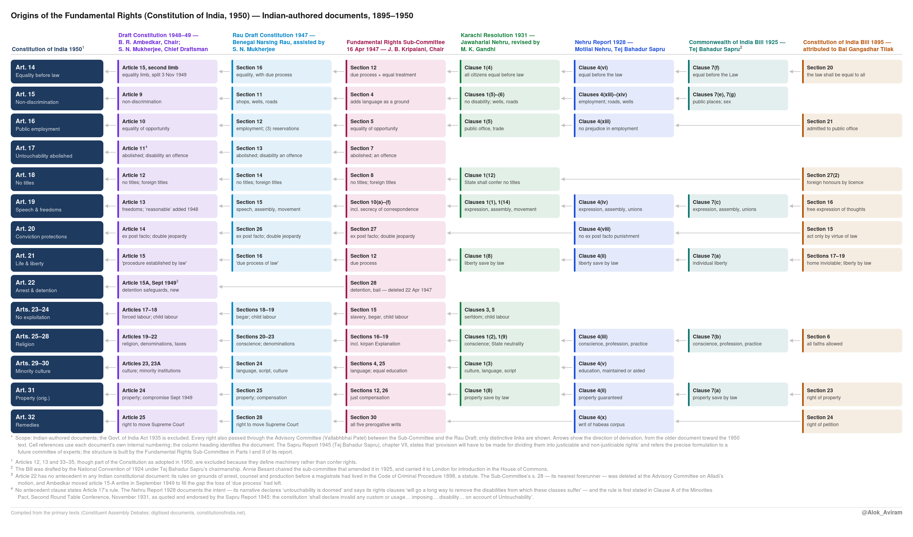
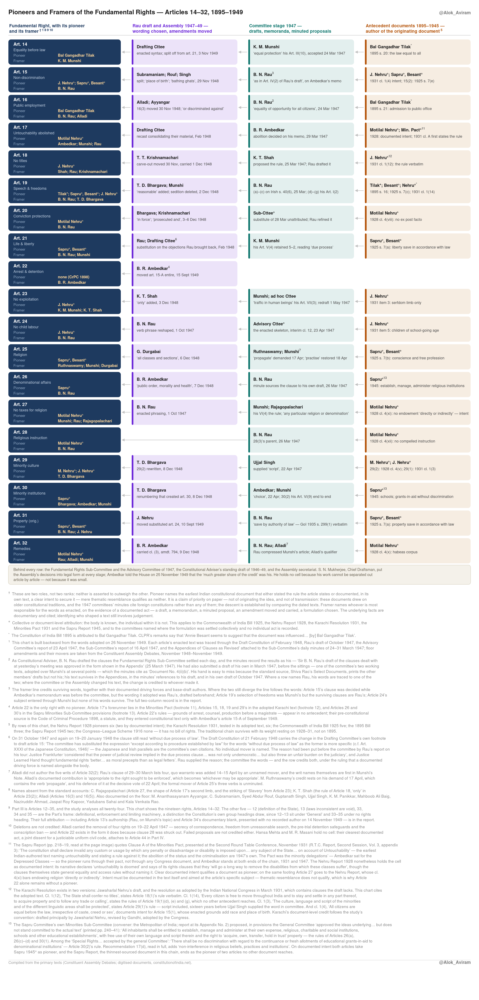
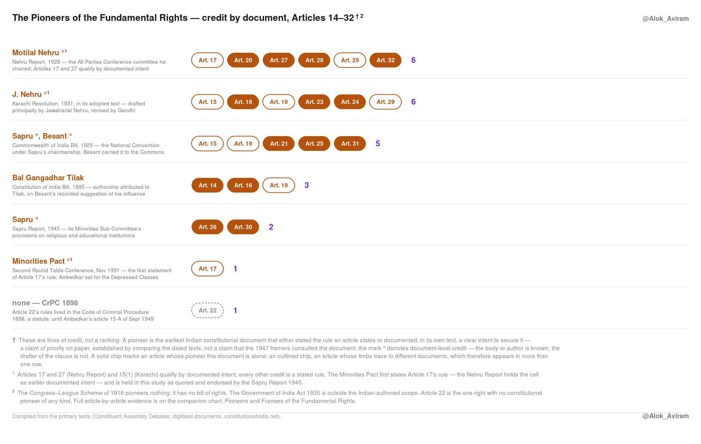

# The Documentary Genealogy of the Indian Constitution: Tracing the Provenance of the Fundamental Rights, 1895–1950

---

## 1. Introduction and Method

The Constitution of India was adopted on 26 November 1949 and came into force on 26 January 1950. The documentary record shows a half-century of accumulation, in which nearly every major provision of the 1950 text can be followed backward through a chain of dated, named, citable antecedents. The chain runs from the anonymous Constitution of India Bill of 1895 through the Commonwealth of India Bill (1925), the Nehru Report (1928), the Karachi Resolution (1931), the Government of India Act (1935), the Sapru Committee Report (1945), the member drafts placed before the Constituent Assembly's Fundamental Rights Sub-Committee in March 1947 (K. M. Munshi's, B. N. Rau's and Ambedkar's *States and Minorities* among them), the Sub-Committee's Report of 16 April 1947 and the Advisory Committee's report of 23 April 1947, B. N. Rau's Draft Constitution (October 1947), the Drafting Committee's Draft Constitution (February 1948), and the floor debates of the Constituent Assembly (1948–49).

This report reconstructs that genealogy. The method is provenance analysis. The scope is the Fundamental Rights: Part III of the Constitution, Articles 12–35, with the nineteen rights of Articles 14–32 at the centre. For each right the report identifies (a) the earliest documented indigenous articulation of the idea, (b) each refinement through the successive documents, and (c) the persons who drafted the final text, so far as the record identifies them.

**Evidence rules.** Primary sources are preferred throughout: the texts of the bills and reports themselves (most of them now digitised at constitutionofindia.net, the Centre for Law and Policy Research's archive of "Historical Constitutions" and committee reports); the Constituent Assembly Debates (CAD), cited by date and speaker, in the official twelve-volume record digitised by the Lok Sabha Secretariat (eparlib.sansad.in); B. Shiva Rao (ed.), *The Framing of India's Constitution: Select Documents*, 5 vols. (Indian Institute of Public Administration, 1966–68); and B. N. Rau, *India's Constitution in the Making* (ed. B. Shiva Rao, Orient Longmans, 1960). Secondary works are used as guides to the primary record rather than as substitutes for it: Granville Austin, *The Indian Constitution: Cornerstone of a Nation* (Oxford, 1966); Rohit De, "Constitutional Antecedents," in *The Oxford Handbook of the Indian Constitution* (2016); and Arvind Elangovan, *Norms and Politics: Sir Benegal Narsing Rau in the Making of the Indian Constitution, 1935–50* (Cambridge, 2019). Where a claim rests on a source I could not check against the primary text, that is flagged at the point where it arises. Where authorship or influence is disputed, as with the 1895 Bill, the competing evidence is set out rather than settled by assertion.

**How this document is organised.** Everything the study asserts is in these pages: every attribution, criterion, correction and caveat. §2 tells the story chronologically, from the Constitution of India Bill of 1895 to adoption. §3 traces each article family's textual descent through the dated documents. §4 sets out what the record documents for each contributor, and closes at §4.12 with the attribution in full, meaning the twenty-four-article table and the evidence behind every cell. §5 is the verification apparatus: scope rules, evidence tiers, the corrections made during verification, the remaining limitations, source criticism, and the assistance disclosure. §6 concludes. §7 presents the charts, and §8 lists the primary sources.

---

## 2. Chronological Narrative, 1895–1950

### 2.1 The Constitution of India Bill, 1895 ("Swaraj Bill")

The earliest known Indian-authored draft constitution is the Constitution of India Bill, 1895. It is a text of 111 sections, with an additional s. 34a, drafted in formal legislative style and complete with preamble, repeal schedule and definitions clause. (The figure of "110 articles" given in the CLPR editorial remarks is contradicted by CLPR's own transcription, which runs to s. 111.) Like the Commonwealth of India Bill thirty years later, it is cast as a Westminster statute. It opens "BE IT ENACTED by the Queen's Most Excellent Majesty by and with advice and consent of the Lords Spiritual and Temporal and Commons." The full text is preserved and digitised by the Centre for Law and Policy Research ([constitutionofindia.net](https://www.constitutionofindia.net/historical-constitution/the-constitution-of-india-bill-unknown-1895/)).

**Attributed to Tilak.** The CLPR archive lists the author as "Unknown (1895)" and notes: "The author of the document remains a mystery; Annie Besant seems to suggest that the document was influenced [by] Bal Gangadhar Tilak — who was the force behind calls for 'Swaraj'." The Tilak attribution therefore rests on Besant's later suggestion (she reprinted the Bill when preparing her own 1925 effort) and on circumstantial plausibility. Tilak's Poona circle contained nationalist legal minds capable of such a text, and Tilak himself was capable of producing one. He held a first-class BA in mathematics (Deccan College, 1877) and an LLB (Government Law College, Bombay, 1879), and his legal competence is independently documented in the conduct of his own sedition defences. Rohit De ("Constitutional Antecedents," *Oxford Handbook of the Indian Constitution*) treats the document as the first articulation of an Indian constitutional imagination without resolving authorship; S. P. Sathe called it the first non-official attempt at drafting a Constitution for India. On the present evidence, the Bill is a document produced in Tilak's milieu, plausibly under his inspiration and possibly by his hand.

What the 1895 Bill actually contains is worth setting out, because the clause numbers matter for the provenance chains below (cited from the CLPR text):

- **§16**: "Every citizen may express his thoughts by words or writings, and publish them in print without liability to censure, but they shall be answerable for abuses, which they may commit in the exercise of this right, in the cases and in the mode the Parliament shall determine." This is free expression with a restrictions proviso, the same two-part architecture as Article 19(1)(a) and 19(2) of 1950.
- **§17**: "Every citizen has in his house an inviolable asylum."
- **§18**: "No one can be imprisoned without a special crime proved against him according to law", an ancestor of the Article 21/22 idea that liberty may be taken away only by law.
- **§20**: "The law shall be equal to all", equality before law (cf. Article 14).
- **§21**: "Every citizen may be admitted to public office" (cf. Article 16).
- **§23**: right of property "except where the law determines otherwise" (cf. original Article 31).
- **§24**: right of petition to sovereign, Parliament and all authorities (cf. Article 32's remedial instinct, here in embryonic, non-justiciable form).
- **§27(2)**: citizenship forfeited by "Those who without the licence of the Government of India accept any office, pension or honour, from any foreign Government". In substance this is the rule of Article 18(3)–(4), enforced by a different sanction, and it is carried forward in spirit at Rau s. 14(2)–(3).

One feature cuts against reading 1895 as a simple anticipation of 1950, and it makes the real continuities more credible for that reason. §11 provides that "The Judicial and the Executive powers shall be subordinate to the Legislative power", which is the reverse of the 1950 scheme, where Articles 13 and 32 subject legislation to judicial review. The 1925 Bill's preamble moves the other way and makes the three branches "independent of each other". The Bill is monarchical, imperial and in places quaint. But as a catalogue of rights ideas in Indian constitutional writing it is the documented headwater.

### 2.2 The Congress–League Scheme (Lucknow Pact), 1916

The Lucknow Pact was the joint Congress–Muslim League scheme negotiated at the December 1916 sessions, with Tilak and Muhammad Ali Jinnah as the principal architects on their respective sides. It has been read in full for this study and the result is negative. Its seven parts concern legislative composition, franchise, executive councils, fiscal division, the Secretary of State, imperial status and the services. It contains no declaration of rights, and no clause on culture, language, script or minority educational institutions. Nothing in it maps to Part III, and it is accordingly excluded from the provenance tables below.

What it did contribute lies elsewhere. Congress conceded separate electorates and fixed proportions of legislative seats, so that every subsequent document had to answer the question Lucknow posed: how does a majority-rule constitution secure minority confidence? That debate runs from Lucknow 1916 to the Nehru Report 1928 (which rejected separate electorates), to the Poona Pact 1932 (reserved seats within joint electorates for the Depressed Classes, negotiated between Gandhi and Ambedkar), to the Sapru Report 1945, to the Minorities Sub-Committee 1947, and to the Advisory Committee's decision of May 1949 abolishing reserved seats for religious minorities while retaining them for SC/ST. It ends in Part XVI, not Part III.

### 2.3 The Commonwealth of India Bill, 1925

The next full-dress draft was the Commonwealth of India Bill, and its authorship needs more care than it usually gets. The Bill was first drafted by the National Convention in April 1924 under the chairmanship of Sir Tej Bahadur Sapru. The Convention was a body of 256 members drawn largely from legislators and ex-legislators, with representation from the Home Rule League, the 1921 Club and the Indian Women's Association. It reconvened at Bombay in December 1924. An All Parties Conference sub-committee chaired by Annie Besant then amended the draft, and the Convention adopted those amendments in April 1925. Labour's George Lansbury introduced it in the House of Commons on 9 December 1925, where it lapsed with Labour's electoral fortunes ([CLPR archive](https://www.constitutionofindia.net/historical-constitution/the-commonwealth-of-india-bill-national-convention-india-1925/)).

The common attribution of the Bill to Besant alone therefore overstates her role and leaves out Sapru's. Her contribution was real. She chaired the amending stage and, as noted below, she preserved the 1895 Bill. But the drafting body was Sapru's Convention. That makes Sapru a three-point figure in the genealogy: chairman of the 1924–25 Convention, member-draftsman of the 1928 committee, and chairman of the 1945 committee that bears his name.

The Bill ran to 127 clauses in ten chapters plus four schedules, and read as a complete constitution. Its rights are gathered at clause 7, sub-clauses (a) to (g): (a) no person deprived of liberty, nor dwelling or property entered, sequestered or confiscated, save in accordance with law; (b) freedom of conscience and free profession and practice of religion; (c) free expression of opinion, peaceable assembly and the forming of associations or unions; (d) free elementary education; (e) equal right to the use of roads, courts of justice and places of public resort; (f) all persons "are equal before the Law, and shall be tried for similar offences in Courts of the same order"; (g) "There shall be no disqualification or disability on the basis of sex."

Clause 7(f) deserves notice. It is a direct equality-before-law guarantee, and it is easily missed if one works from summaries that list only the "seven rights" by theme. The sex-equality clause at 7(g) is the earliest such guarantee in the lineage. And clauses 7(a)–(c) reappear almost verbatim as Nehru Report clauses 4(ii)–(iv) three years later, with 7(a) surfacing again as Karachi clause 1(8) in 1931. That is the clearest chain of textual descent in the whole genealogy.

A negative finding, from a full reading of the Bill including its schedules: there is no clause on minority culture, language, script or educational institutions. With the same result for 1895 and 1916, this establishes that the lineage of Articles 29–30 begins only with the Nehru Report of 1928. The documents do not form a steady march toward 1950, and an account that presents them that way is describing something other than the record.

### 2.4 The Nehru Report, 1928

When the all-white Simon Commission provoked the challenge, in Birkenhead's taunt that Indians could not produce an agreed constitution, the All Parties Conference appointed a committee under Motilal Nehru. Its members were Sir Tej Bahadur Sapru, Sir Ali Imam, M. S. Aney, Mangal Singh, Shuaib Qureshi, G. R. Pradhan and Subhas Chandra Bose; Jawaharlal Nehru served as one of the secretaries. Its report of August 1928 ([CLPR archive](https://www.constitutionofindia.net/historical-constitution/nehru-report-motilal-nehru1928/)) is the first Indian constitutional outline written as a draft for immediate enactment. Its clause 4 contains nineteen enumerated fundamental rights, and it is the first Indian demand that rights be entrenched, that is, placed beyond legislative abridgment. Sapru is generally credited with much of the lawyerly drafting alongside Motilal Nehru; the committee's composition is itself the citation for collective authorship.

The rights catalogue covers personal liberty, freedom of conscience and religion, free expression of opinion, peaceful assembly, equality before the law regardless of "religion, caste, creed or sex," free elementary education, equal access to public roads, wells and places of public resort, and the franchise for men and women alike. It consolidates the 1895 and 1925 streams and adds the anti-caste-discrimination note that becomes Articles 15 and 17. Granville Austin's tally, made against the final text, remains the standard measure of this document's yield: of the Nehru Report's nineteen sub-clauses, ten reappear, materially unchanged, in the Fundamental Rights of 1950, and three more in the Directive Principles (*Cornerstone*, ch. 3). The Report also rejected Lucknow's separate electorates in favour of joint electorates with reserved seats, the decision that framed the minority-safeguards question the 1947 committees inherited.

### 2.5 The Karachi Resolution, 1931

The Resolution on Fundamental Rights and Economic Programme was adopted by the Congress at its Karachi session in March 1931, with Vallabhbhai Patel presiding. It was drafted principally by Jawaharlal Nehru and revised by Gandhi ([CLPR archive](https://www.constitutionofindia.net/historical-constitution/karachi-resolution-1931-jawaharlal-nehru/); [Nehru Archive](https://nehruarchive.in/documents/resolution-on-fundamental-rights-31-march-1931-llwk7)). Its twenty heads repeat and sharpen the civil-liberties core of 1928. The rule-by-rule pioneer testing in this study (§4.12) found that the *adopted* Karachi text, which differs from the Nehru-draft version circulated in some collections, states rules the earlier documents only gesture at: cl. 1(3) on the culture, language and script of minorities (Article 29(1)); cl. 1(4) on equality irrespective of caste, creed or sex (Article 15(1), as intent); cl. 1(12) "The State shall confer no titles" (Article 18, verbatim); cl. 1(14) on free movement, settlement, property and calling (Article 19(d), (e), (g)); and items 3 and 5 on serfdom and child labour (Articles 23–24). Its socio-economic guarantees, the living wage, labour protections and state control of key industries, flow to the Directive Principles of Part IV and are outside this report's scope. A genealogy that names Tilak and Besant but omits Karachi leaves out Jawaharlal Nehru as a drafter, not merely a mover of resolutions, and is to that extent incomplete.

### 2.6 The Government of India Act, 1935

The imperial statute stands in the genealogy differently from the nationalist drafts. It was enacted law; it worked institutions; it trained personnel, Rau's entire professional formation among them. It contains no fundamental rights, and that absence is what the nationalist documents from 1895 onward were answering. Its bearing on Part III is nonetheless textual at one point. Section 299(1), "No person shall be deprived of his property save by authority of law", was transcribed by Rau into what became Article 31(1), an act of transcription comparable to Munshi's of the US Fifth Amendment at Article 21 (§4.12). More broadly, the Act's machinery is what made the 1950 Constitution work in detail, while the nationalist documents gave it its meaning. Ambedkar defended the borrowing without apology when introducing the Draft (CAD, vol. VII, 4 November 1948).

### 2.7 The Sapru Committee Report, 1945

The Non-Party Conference's Conciliation Committee was appointed in November 1944 under Sir Tej Bahadur Sapru. It had about thirty members, eight of whom later sat in the Constituent Assembly, and it reported in 1945 ([CLPR archive](https://www.constitutionofindia.net/historical-constitution/sapru-committee-report-sir-tej-bahadur-sapru-1945/); full text at [archive.org](https://archive.org/details/saprucommittee035520mbp)). Its 300-plus pages addressed the communal deadlock, minority safeguards and the mechanics of a constitution-making body. Its distinctive analytic contribution, and the one that survives into the very architecture of the 1950 text, is that it was the first Indian document to formally propose dividing fundamental rights into justiciable and non-justiciable categories. That distinction, refined by B. N. Rau's notes of 1946 and by the Fundamental Rights Sub-Committee in 1947, became the Part III / Part IV divide. The Report also insisted that fundamental rights "must" be written into any future constitution, and it elaborated minority protections (non-discrimination, culture, language, representation) that inform Articles 25–30. Sapru thus appears twice in the genealogy in a documented, personal capacity: as a principal draftsman of 1928 and as chairman-author of 1945.

### 2.8 Cabinet Mission Plan and the Objectives Resolution, 1946

The Cabinet Mission's Statement of 16 May 1946 supplied the procedure: an indirectly elected Constituent Assembly and, in its advisory committee proposal, the germ of the Assembly's Advisory Committee on Fundamental Rights, Minorities, etc. The Assembly first met on 9 December 1946. On 13 December 1946 Jawaharlal Nehru moved the Objectives Resolution, adopted on 22 January 1947. It declared that the future constitution would guarantee "all the people of India justice, social, economic and political; equality of status, of opportunity, and before the law; freedom of thought, expression, belief, faith, worship, vocation, association and action," with "adequate safeguards... for minorities, backward and tribal areas, and depressed and other backward classes" ([CAD, 13 December 1946](https://www.constitutionofindia.net/debates/13-dec-1946/)). For Part III the Resolution is the charter. The rights committees of 1947 worked under its terms.

### 2.9 The Assembly's Committees, 1947

Between January and August 1947 the substantive decisions were made in committees, not on the floor, and any account of attribution has to name their chairs and working members.

- **Advisory Committee on Fundamental Rights, Minorities and Tribal and Excluded Areas**. Chairman Vallabhbhai Patel; constituted 24 January 1947; more than fifty members. It appointed the five sub-committees on 27 February 1947. Its report on justiciable fundamental rights went forward under Patel's letter of 23 April 1947 and was presented to the Assembly on 29 April 1947. The supplementary report on political safeguards is dated 8 August 1947 and was debated on 27–28 August, with a further supplementary report presented on 30 August. Patel's covering letter of 8 August is explicit that the two are distinct in subject matter. The distinction matters, because the cultural and educational rights of Articles 29–30 belong to the April report, not the August one.

  The August report also rejected a constitutional guarantee of minority representation in the public services, the very thing Ambedkar had sought in *States and Minorities*: "We are not aware of any other constitution in which such a guarantee exists, and, on merits, we consider, as a general proposition that any such guarantee would be a dangerous innovation" (para 14). Article 16(4) as enacted is therefore an enabling provision, not an inherited guarantee. Here the lineage runs through a refusal. Paragraphs 15 and 16 carried forward the Minority Officer and the backward-classes commission, which became Articles 338 and 340.
- **Fundamental Rights Sub-Committee**. Chairman J. B. Kripalani; ten members, including B. R. Ambedkar, Alladi Krishnaswami Ayyar, Hansa Mehta and M. R. Masani. Appointed 27 February 1947. At its first meeting Alladi advised taking the United States "as their model for the protection of the basic rights of the citizens." Draft-rights memoranda were submitted by K. M. Munshi, Ambedkar, Harnam Singh and Alladi, and the sub-committee also worked from notes by B. N. Rau and K. T. Shah.

  The six texts before it, and their standing in the record:

| Text | Author | Standing in the record |
|---|---|---|
| Draft on fundamental rights | **K. M. Munshi** | The **ordering text**. The committee worked down its articles in sequence |
| Draft (Constitutional Adviser's) | **B. N. Rau** | The **second working text**, examined alongside Munshi's; his clauses preferred to Munshi's at several points |
| *States and Minorities* | **B. R. Ambedkar** | A full mini-constitution, submitted for the All-India Scheduled Castes Federation. Shaped the agenda more than the language |
| Untouchability draft, 18 March | **Harnam Singh** | "The recognition of untouchability shall be a crime in India." Not adopted |
| Memorandum and notes | **Alladi Krishnaswami Ayyar** | Advised the US model at the first meeting; later moved four deletions, all carried |
| Notes | **K. T. Shah** | His note of 23 December 1946 carries the earliest documented "begar" (Article 23); he proposed Article 18's rule on 25 March |

  Its Report of 16 April 1947 is the first version of what became Part III, and the most important single document of the committee stage. It runs to 45 sections, already divided into Part I (justiciable, ss. 1–32) and Part II (non-justiciable principles, ss. 33–45). This is the Sapru division put into operation, with s. 33 almost verbatim the future Article 37. Nearly every article family in Part III has its immediate ancestor here: s. 4 (non-discrimination, including *language* as a prohibited ground), s. 5 (public employment), s. 7 (untouchability), s. 8 (titles), s. 10 (the freedoms, including a right to secrecy of correspondence that did not survive), s. 12 (life, liberty and property "without due process of law" combined with "equal treatment of the laws", the origin of the fused clause that Rau and the 1948 draft inherit and the 1949 revision splits into Articles 14 and 21), s. 15 (forced labour and child labour), ss. 16–19 (religion, s. 16 carrying the kirpan Explanation in its original form), s. 25 (equal opportunities of education), s. 26 (compensation for property), s. 27 (conviction protections), s. 28 ("No person shall be subjected to prolonged detention preceding trial, to excessive bail, or unreasonable refusal thereof, or to inhuman or cruel punishment"), s. 30 (the Supreme Court and all five prerogative writs), s. 31 (armed forces) and s. 32 (enabling legislation).

  Note that at this stage "all persons shall be equal before the law" sat in s. 35(1), inside the non-justiciable Part. Ambedkar's memorandum, *States and Minorities* (submitted 15 March 1947 on behalf of the All-India Scheduled Castes Federation, published 1947; [CLPR archive](https://www.constitutionofindia.net/historical-constitution/states-and-minorities-dr-b-r-ambedkar-1947/)), was a mini-constitution with preamble and articles. Among other things it proposed constitutional "State socialism", with nationalised key industries and collectivised agriculture entrenched as rights, protections against "invasion" of minority rights, and remedies. At the sub-committee's meeting of 24 March 1947 "it was decided to take up Mr. Munshi's draft and examine it in conjunction with other drafts". Munshi's draft supplied the order of business, but Rau's draft was the second working text before the committee, and where the two were compared the committee twice preferred Rau's: "As regards Article II of Mr. Munshi's draft, it was decided to adopt Article I, sub-sections (1) and (2) of Sir B. N. Rau's draft", and on a proposed change to that wording five of eight members were "in favour of retaining the words as drafted by Sir B. N. Rau". The sub-committee's product, as revised by Patel's Advisory Committee, became the floor's April 1947 rights text.

**What the committee cited, and what it did not.** Across the full minutes of the Fundamental Rights Sub-Committee and the Advisory Committee as printed in Shiva Rao vol. II, there is no named reference to the Constitution of India Bill 1895, the Commonwealth of India Bill 1925, the Nehru Report 1928, the Karachi Resolution 1931, the Lucknow Pact 1916 or the Sapru Committee Report 1945. What the members cite by name, repeatedly, are foreign constitutions. In full:

| Cited | Where | Result |
|---|---|---|
| **US Constitution, Fourteenth Amendment** | Alladi, 27 Feb 1947 | "Sir Alladi advised the sub-committee to take the United States as their model for the protection of the basic rights of the citizens" |
| **Irish Constitution, s. 40(6)** | drafting of a clause | "drafted on the basis of section 40(6) of the Irish Constitution" |
| **Irish Constitution, s. 44(6)** | Alladi, 27 Mar 1947 | "proposed a clause as in section 44, sub-section 6 of the Irish Constitution, but excluding educational institutions. The insertion of such a clause was accepted" |
| **Irish Constitution, Art. 40 cl. (3)** | habeas corpus suspension | "as in clause (3) of Article 40 of the Irish Constitution" |
| **US Thirteenth Amendment** | forced labour | "a provision on the lines of the American clause against 'slavery and involuntary servitude'" — later struck on Rajagopalachari's objection, which is why Article 23 does not use the word |
| **US Fourth Amendment** | search and seizure | Adopted verbatim, then deleted on Alladi's motion |
| **Constitution of Australia, s. 116** | religious freedom | Case material circulated to the committee |

It follows that the line from 1895 through 1925, 1928 and 1931 to the Sub-Committee's report is textual descent established by comparison, not documented transmission. No minute shows a member working from an Indian antecedent. That does not make the descent unreal. The Nehru Report's clause 4(viii) is Article 20(1) in all but wording, its Note to clause 4 carries the kirpan Explanation, and "maintained or aided by the State" in 4(v) reaches Article 29(2). But influence carried in the formation of the drafters is not the same thing as citation, and the two should be kept apart. The justiciable/non-justiciable split (after Sapru 1945 and Rau's notes) was applied here, and the non-justiciable residue was routed toward what became Part IV.
- **Minorities Sub-Committee**. Chairman H. C. Mookherjee; 26 members, the largest of the five, including Frank Anthony, Sardar Ujjal Singh, Rajkumari Amrit Kaur and Jagjivan Ram. It met on 17–19 April 1947, and its brief Interim Report of 19 April carries the recommendation (iii) that underlies Article 29's substance (§4.12). It then met daily from 21 to 27 July 1947 and reported on 27 July. The July agenda was fixed by questionnaire to four items: legislative representation, Cabinet seats, services and administrative machinery. The July report therefore contains nothing on religion and nothing on minority culture or education. Those come from the Fundamental Rights Sub-Committee, a point on which much of the secondary writing is mistaken.

  Two of its minuted decisions, Ambedkar's minority-safeguards officer (accepted 16 to 2, and the origin of Article 338) and Munshi's backward-classes commission (Article 340), end up outside Part III. They are noted here because the same sitting documents Ambedkar's working method. He won the office and lost its independence: a proposal to make the officer independent of the executive "like the Auditor-General" was negatived 9 to 6.

  Rajkumari Amrit Kaur filed a minute of dissent, opposing reservation and weightage for any community. Ambedkar's proposal that majority-community candidates poll a minimum of minority votes before election "was lost by a large majority, only Dr. Ambedkar voting for it."

### 2.10 B. N. Rau: Notes, Precedents, Draft of October 1947, Foreign Tour

Sir Benegal Narsing Rau, an ICS jurist, was appointed the Assembly's honorary Constitutional Adviser in July 1946. He began the draft in September 1947 and completed it in about a month, assisted by S. N. Mukherjee, the Assembly's Joint Secretary and Draftsman. Mukherjee's hand is therefore on three of the four drafting stages, not only the last. The Assembly's instruction was to consolidate the committee reports already settled on the floor, so much of the draft is compilation. Several families of provisions were expressly marked as pending Assembly review, and it is chiefly in those that Rau's own constitutional preferences can be seen.

His documented outputs frame the whole drafting process. First, the Notes on Fundamental Rights of 2 September 1946 (Shiva Rao vol. II, p. 21; [CLPR archive](https://www.constitutionofindia.net/historical-constitution/preliminary-notes-on-fundamental-rights-1946-b-n-rau/)). These are printed there under a heading that also covers a separate note by K. T. Shah of 23 December 1946, and the two should not be confused. Second, his *Constitutional Precedents*, digests of foreign constitutions that put comparative material on the rights committee's table; this is the channel through which the Irish and American models named in the minutes arrived. Third, on the Assembly's instruction of August 1947, the Draft Constitution of October 1947, some 240 articles and 13 schedules, synthesising the committee reports with precedent ([CLPR, Draft Constitution prepared by the Constitutional Adviser](https://www.constitutionofindia.net/committee-report/draft-constitution-prepared-by-the-constitutional-adviser/)). Within its Part III chapter, his s. 13 adds "the imposition of any disability on that account shall be an offence which shall be punishable in accordance with law", which becomes Article 17's second sentence. His s. 15(1) lists five freedoms, the Sub-Committee's secrecy of correspondence having already fallen at the Advisory Committee on Alladi's motion. "Language" disappears as a prohibited ground of discrimination at his hand. And his s. 26 carries a saving for the Indian Evidence Act that later vanishes without record. This was the working text the Drafting Committee revised from 30 October 1947 onward.

In late 1947 Rau toured the United States, Canada, Ireland and Britain, consulting judges and statesmen. The American consultations left the visible mark on Part III. Justice Felix Frankfurter of the US Supreme Court advised him against a substantive "due process" clause, and the advice can now be cited at first hand. Rau's report on the tour (Shiva Rao vol. III, p. 218) records that Frankfurter "considered that the power of judicial review implied in the due process clause… was not only undemocratic (because it gave a few judges a power of vetoing legislation enacted by the representatives of the nation) but also threw an unfair burden on the judiciary", and that Justice Learned Hand "considered that it would be better to have all fundamental rights as moral precepts than as legal fetters in the Constitution". The Drafting Committee had retained "due process" on 31 October 1947 and still had it on 19–20 January 1948. It made the substitution in its final revision, and recorded it in its own footnote to draft article 15 of 21 February 1948: "The committee has substituted the expression 'except according to procedure established by law' for the words 'without due process of law' as the former is more specific (c.f. Art. XXXI of the Japanese Constitution, 1946)", adding the Irish parallel. The Japanese citation is thus the committee's own and not a scholarly inference. This is one of the most consequential single edits in the Constitution's history. It was fought over on the floor and only partially undone decades later in *Maneka Gandhi* (1978). (Rau, *India's Constitution in the Making*; Elangovan, *Norms and Politics*; the tour report and the footnote are in Shiva Rao vol. III, read at first hand for this study.)

### 2.11 The Drafting Committee and the Assembly, 1947–1949

The Assembly elected the Drafting Committee on 29 August 1947. Its members were B. R. Ambedkar (chairman, elected by the committee on 30 August), Alladi Krishnaswami Ayyar, N. Gopalaswami Ayyangar, K. M. Munshi, Saiyid Mohammed Saadulla, B. L. Mitter (soon replaced by N. Madhava Rau), and D. P. Khaitan (who died in 1948 and was replaced by T. T. Krishnamachari). Supporting them stood the Assembly secretariat under H. V. R. Iengar, with S. N. Mukherjee, Joint Secretary and Chief Draftsman, responsible for casting decisions into legislative language.

The committee revised Rau's draft into the Draft Constitution of February 1948 (315 articles, 8 schedules). That draft was published for public comment, revised again against thousands of amendments, and debated clause by clause on the floor from 4 November 1948 (Ambedkar's introductory speech) to the third reading, which concluded on 25–26 November 1949. Roughly 7,600 amendments were tabled and about 2,400 moved; the final text contained 395 articles and 8 schedules. The Assembly sat for 167 plenary days ([CLPR, Constituent Assembly Debates archive](https://www.constitutionofindia.net/constitution-assembly-debates/)). Part III was debated from 25 November to 13 December 1948, with three later reopenings: Article 31 (10 and 12 September 1949), Article 22 (15–16 September 1949) and Article 19 (16–17 October 1949).

The Drafting Committee's revision letter of 3 November 1949 made the last structural change: "Article 21 (old 15): We have considered it more appropriate to split up this article into two parts and to transfer the latter part of this article dealing with 'equality before law' to a new article 14 under the heading 'Right to Equality'". That is why Article 14 has no draft-article ancestor of its own. The renumbering between the February 1948 draft and the enacted Constitution is a standing source of confusion in the secondary literature. The concordance, for reference:

| Feb 1948 draft | Constitution 1950 |
|---|---|
| art. 7 | Art. 12 |
| art. 8 | Art. 13 |
| art. 9 | Art. 15 |
| art. 10 | Art. 16 |
| art. 11 | Art. 17 |
| art. 12 | Art. 18 |
| art. 13 | Art. 19 |
| art. 14 | Art. 20 |
| **art. 15** | **Arts. 14 *and* 21** (split, 3 Nov 1949) |
| art. 15-A | Art. 22 (new, moved 15 Sept 1949) |
| art. 16 | moved out of Part III — Part XIII, Art. 301 |
| arts. 17–18 | Arts. 23–24 |
| art. 19 | Art. 25 |
| arts. 20–22 | Arts. 26–28 |
| art. 23 | Art. 29 |
| art. 23-A | Art. 30 (created by renumbering, 8 Dec 1948) |
| art. 24 | Art. 31 |
| art. 25 | Art. 32 |

---

## 3. Article-Family Provenance Tables

Conventions: "1895 §n" cites the Constitution of India Bill 1895 by clause (text verified against the CLPR digitised edition); "CoIB 1925" the Commonwealth of India Bill, cited by clause (read in full; see §5.2); "NR 1928 cl. 4" the Nehru Report's fundamental-rights clause; "Karachi 1931" the Resolution on Fundamental Rights and Economic Programme; "GoI 1935 s. n" the Government of India Act 1935; "S&M 1947" Ambedkar's *States and Minorities*; "Rau Draft 1947" the Constitutional Adviser's October 1947 draft; "Draft 1948 art. n" the Drafting Committee's February 1948 draft; "Art. n" the Constitution of 1950.

### 3.1 Fundamental Rights (Part III)

Every chain below is built from full-text readings of the source documents. "FR Sub-Cttee" is the Report of the Sub-Committee on Fundamental Rights, 16 April 1947; "S&M" is Ambedkar's *States and Minorities*.

| Right (1950) | Chain of antecedents |
|---|---|
| Equality before law, Art. 14 | 1895 §20 → **CoIB 1925 cl. 7(f)** → NR 1928 cl. 4 → Karachi cl. 1(4) → **FR Sub-Cttee s. 12** (due process fused with equal treatment) → Rau s. 16 → Draft 1948 art. 15, second limb → split into a new Art. 14 by the Drafting Cttee's letter of 3 Nov 1949 |
| Non-discrimination & access, Art. 15 | CoIB cll. 7(e), 7(g) → NR 1928 cl. 4 ("Men and women shall have equal rights as citizens"; no disability on account of religious belief) → Karachi cll. 1(5)–(6) → **FR Sub-Cttee s. 4** (adds *language* as a prohibited ground) and S&M cll. 4–6, 16 → Rau s. 11 → Draft art. 9 → CAD 29 Nov 1948: an amendment adding the Scheduled Castes and Tribes to the special-provisions clause was **opposed by Ambedkar and rejected**; "place of birth" (Syed Abdur Rouf) and "bathing ghats" (Guptanath Singh) added, the clause split by C. Subramaniam → Art. 15. *Language* was dropped by Rau in his October 1947 draft — his s. 11 reads "religion, race, caste, sex or any of them"; it survives only at Article 29(2) |
| Public employment, Art. 16 | 1895 §21 → NR 1928 cl. 4 → Karachi cl. 1(5) → **FR Sub-Cttee s. 5**; Ambedkar's guarantee of representation in services (S&M Art. II Sec. IV cl. 3) **rejected by the Advisory Cttee, 8 Aug 1947, para 14** → Rau s. 12(3), enabling form → Draft art. 10 → Art. 16(4) |
| **Abolition of untouchability, Art. 17** | No antecedent clause states the rule → NR 1928, documented *intent* (its narrative: "untouchability is doomed"; the rights clauses "will go a long way to remove the disabilities from which these classes suffer") → **Minorities Pact, 2nd RTC, Nov 1931, cl. A** — the first statement of the rule, quoted and endorsed by Sapru 1945 (props. 7–8) → **Munshi's draft** ("Untouchability is abolished, and the practice thereof is punishable by the law of the Union"), Harnam Singh's draft 18 Mar 1947, and S&M — the abolition decided 29 Mar 1947 while Ambedkar's memorandum was under consideration → **FR Sub-Cttee s. 7** → **Rau s. 13**, adding "the imposition of any disability on that account shall be an offence which shall be punishable in accordance with law" → Draft art. 11 → Art. 17, adopted unchanged, CAD 29 Nov 1948. **The second sentence of Art. 17 originates with Rau, not with the Sub-Committee.** See §4.12 |
| **Abolition of titles, Art. 18** | **1895 §27(2)** (foreign honours only by licence, enforced by loss of citizenship) → Karachi cl. 1(12) → **FR Sub-Cttee s. 8** → Rau s. 14 → Draft art. 12 → Art. 18 |
| Freedoms, Art. 19 | 1895 §16 (speech + abuse proviso) → CoIB cl. 7(c) → NR 1928 cl. 4(iv) → Karachi cll. 1(1), 1(14) → **FR Sub-Cttee s. 10(a)–(f)** and S&M cll. 7, 12 → Rau s. 15 → Draft art. 13 → CAD 1–2 Dec 1948: **Bhargava's "reasonable" inserted** and **Munshi's deletion of "sedition"**, both accepted by Ambedkar and adopted → contempt of court added on **T. T. Krishnamachari's** motion, 17 Oct 1949 → Art. 19. Section 10(d), secrecy of correspondence, was deleted at the Advisory Committee on Alladi's motion, 19 Apr 1947 ("Para (d) was decided to be deleted") |
| **Conviction protections, Art. 20** | 1895 §15 (a general legality principle, and the loosest link in this table) → **NR 1928 cl. 4(viii)** ("No person shall be punished for any act which was not punishable under the law at the time it was committed" — Article 20(1) in all but wording) → **FR Sub-Cttee s. 27(1)–(2)** and S&M cl. 13; US model urged by Alladi, 27 Feb 1947 → Rau s. 26 → Draft art. 14 → Art. 20 |
| Personal liberty, Art. 21 | 1895 §§17–19 → CoIB cl. 7(a) → NR 1928 cl. 4(ii) → Karachi cl. 1(8) → **FR Sub-Cttee s. 12** → Rau s. 16 ("due process") → **Frankfurter–Rau consultation, late 1947; Drafting Cttee substitutes "procedure established by law"** → Draft art. 15 → CAD 6–13 Dec 1948 → Art. 21 |
| **Arrest and detention, Art. 22** | **No Indian constitutional antecedent states its rules** — grounds of arrest, counsel, production before a magistrate lived in the Code of Criminal Procedure 1898, a statute (the general liberty clauses of 1895–1931 belong to Art. 21's lineage) → **FR Sub-Cttee s. 28** (pre-trial detention, bail, cruel punishment — its nearest forerunner) deleted at the Advisory Cttee on Alladi's motion → *absent from Rau's draft and the Feb 1948 text* → draft art. 15A moved by Ambedkar, 15 Sept 1949, to compensate for the deletion of due process → Art. 22 |
| Against exploitation, Arts. 23–24 | Karachi items 3, 5 → **FR Sub-Cttee s. 15** and S&M cl. 9 → Rau ss. 18–19 → Draft arts. 17–18 → Arts. 23–24 |
| Religion, Arts. 25–28 | 1895 §6 → CoIB cl. 7(b) → NR 1928 cl. 4(iii) (adding "no state religion") → Karachi cll. 1(2), 1(9) → **FR Sub-Cttee ss. 16–19**, s. 16 carrying the kirpan Explanation in its original form → Rau ss. 20–23 → Draft arts. 19–22 → Arts. 25–28 |
| Minorities' culture & education, Arts. 29–30 | No antecedent in 1895, 1916 or 1925 → **NR 1928 cl. 4** → Karachi cl. 1(3) → Sapru 1945, ch. VII (paras 298–376) → **FR Sub-Cttee ss. 4, 25**, carried by the Advisory Cttee's justiciable-rights report of 23 Apr 1947 → Rau s. 24 → Draft arts. 23, 23A → Arts. 29–30 |
| Property (orig. Art. 31) | 1895 §23 → CoIB cl. 7(a) → NR 1928 cl. 4(ii) → Karachi cl. 1(8) → **FR Sub-Cttee ss. 12, 26** → Rau s. 25 → Draft art. 24 → substituted article moved by **Jawaharlal Nehru**, 10 Sept 1949, adopted as amended 12 Sept. GoI 1935 s. 299 is a further antecedent, outside the Indian-authored scope |
| **Remedies, Art. 32** | 1895 §24 (petition, non-justiciable germ) → NR 1928 cl. 4 (**writ of habeas corpus**, suspendable in war or rebellion by Act of the central legislature) → **FR Sub-Cttee s. 30**, already listing all five prerogative writs and the suspension clause that becomes Art. 359; S&M Art. II Sec. II cl. 1 → Rau s. 28 → Draft art. 25 → Art. 32 — "an article without which this Constitution would be a nullity… the very soul of the Constitution and the very heart of it" (Ambedkar, CAD, 9 Dec 1948) |

### 3.2 Minority and SC/ST safeguards, so far as they bear on Part III

This stream is retained because it produced Articles 15(4), 16(4) and 17. The representation provisions of Part XVI (Arts. 330–342) fall outside the scope of this report and are noted only where they explain a Part III outcome.

Chain: Lucknow Pact 1916 (separate electorates) → NR 1928 (joint electorates with reservations) → Communal Award and the Poona Pact 1932 (Gandhi–Ambedkar: reserved seats for the Depressed Classes within joint electorates) → GoI 1935 (the Scheduled Castes schedule, and the term itself) → Sapru 1945 (minority safeguards; a proposed minorities commission) → S&M 1947 → Minorities Sub-Cttee (Mookherjee) and the Advisory Cttee report of August 1947 → Advisory Cttee, 11 May 1949, one dissenting vote: reserved seats for religious minorities abolished, SC/ST reservations retained. Patel placed the decision before the Assembly on 25 May 1949 and Nehru supported it on 26 May, with Begum Aizaz Rasul speaking in favour.

Two consequences fall inside Part III. Ambedkar's guarantee of minority representation in the services was rejected by the Advisory Committee on 8 August 1947 as "a dangerous innovation", so Article 16(4) is enabling rather than mandatory (§3.1, §4.12). The commissioner stream (Sapru's proposal, the machinery of *States and Minorities*, the minuted vote of 27 July 1947) ends outside Part III, in Article 338, and is not pursued here.

---

## 4. The Contributors: What the Record Documents for Each

### 4.1 Bal Gangadhar Tilak (1856–1920)

Documented: the political force behind the Swaraj demand within which the 1895 Bill was produced; co-architect (with Jinnah) of the Lucknow Pact, 1916, which framed the minority-safeguards problem for thirty years; legal training (LLB, Government Law College, Bombay, 1879) sufficient to have drafted the Bill himself. Attributed to Tilak: the 1895 Bill. The attribution is traditional rather than demonstrated, and this report adopts it on that footing. It rests on Annie Besant's later suggestion of Tilak's influence (noted in the CLPR editorial remarks to the Bill) and on inference from milieu and capability. Tilak himself never claimed it. On the record, Tilak stands as the inspirer of the earliest documented Indian constitutional draft and its most plausible candidate-author; proof of authorship is absent. No other named figure stands closer to the 1895 text.

### 4.2 Annie Besant (1847–1933)

Documented: convener of the National Convention that produced the Commonwealth of India Bill, 1925, the first Indian draft constitution with named, organised, collective authorship and the first to find a parliamentary vehicle (Lansbury's introduction in the Commons, December 1925). Specific ideas entering the rights stream through her Bill: the sex-equality guarantee and the equal use of roads, courts of justice and places of public resort. She also preserved and republicised the 1895 Bill. She is the reason the first link in the chain survives.

### 4.3 Motilal Nehru (1861–1931) and the 1928 committee

Documented: chairman of the All Parties Conference committee whose Report is the first Indian outline with entrenched, justiciable fundamental rights, parliamentary government and joint-electorate minority protections. The measurable yield, ten of nineteen rights sub-clauses surviving materially unchanged into Part III and three into Part IV (Austin, *Cornerstone*, ch. 3), makes the Nehru Report, clause for clause, the most productive single nationalist source of Part III.

### 4.4 Sir Tej Bahadur Sapru (1875–1949)

Documented twice: as a leading member-draftsman of the 1928 committee, and as chairman of the 1945 Conciliation Committee. That committee's report first proposed the justiciable/non-justiciable division that became the Part III / Part IV architecture, insisted that fundamental rights "must" be constitutionalised, and elaborated the minority-safeguard designs that inform Articles 25–30; its Minorities Sub-Committee propositions are the pioneer texts of Articles 26 and 30 (§4.12). Sapru died in January 1949, before the Constitution was completed, and he never sat in the Assembly. His influence is entirely documentary, which is why it can be traced.

### 4.5 Jawaharlal Nehru (1889–1964)

The popular lineages of the rights tradition leave him out. The record does not allow it. Documented: principal draftsman of the Karachi Resolution 1931 (with Gandhi's revision), the pioneer text for Articles 15(1), 18, 19(d)–(g), 23, 24 and 29(1); mover of the substituted property article on 10 September 1949 (amendment No. 369), which makes him the only person in both the pioneer and framer columns of the chart (§4.12); and mover and principal author of the Objectives Resolution (CAD, 13 December 1946), the charter under which the rights committees worked.

### 4.6 Vallabhbhai Patel (1875–1950)

Documented: chairman of the Advisory Committee, over whose signature the fundamental-rights text reached the Assembly floor in April 1947 (letter of 23 April 1947), and under whose chairmanship the deletions of April 1947 (search and seizure, secrecy of correspondence, the detention safeguards) were carried. Presided at Karachi, 1931.

### 4.7 B. N. Rau (1887–1953)

Documented: honorary Constitutional Adviser from July 1946; author of the Notes on Fundamental Rights of 2 September 1946; the draftsman of the Fundamental Rights Sub-Committee's clauses after each day's sitting in March 1947. The Appendices of "Clauses as Revised" attached to its minutes are his, as the minutes themselves state, and they carry the surviving words of much of Part III. This is easy to miss, because Shiva Rao prints the other members' drafts but not his. He was the author of the Draft Constitution of October 1947, the working text of the entire final phase, and he conducted the foreign consultations of late 1947, including the one with Frankfurter that produced the "procedure established by law" formulation of Article 21. He served the Drafting Committee continuously thereafter; his memoranda and revisions are printed throughout Shiva Rao's *Framing*, vols. III–IV.

Ambedkar's own floor statement of 25 November 1949 credits him by name (quoted in §4.8). The Assembly's President did the same the following day. Closing the proceedings on 26 November 1949, Rajendra Prasad told the House that the committees' recommendations "were adopted as the basis on which the draft of the Constitution had to be prepared. This was done by Mr. B. N. Rau, who brought to bear on his task a detailed knowledge of Constitutions of other countries and an extensive knowledge of the conditions of this country as well as his own administrative experience". The Drafting Committee then worked "on the original draft prepared by Mr. B. N. Rau". In the same passage Prasad assigns "the credit for the fundamentals of our Constitution" to the committees chaired by Nehru and Patel (CAD, 26 November 1949). On the day Rau died, Nehru told the Lok Sabha that "he was intimately connected with this Constitution-making, and he might well be called one of the principal architects of our Constitution", adding that Burma had sent for him to help make its constitution while he was making India's (*Lok Sabha Debates*, 30 November 1953, cols. 1027–30). Elangovan's *Norms and Politics* is the standard scholarly reconstruction. Rau took no fee. In 1949 he left to represent India at the UN, and he later sat on the International Court of Justice.

### 4.8 B. R. Ambedkar (1891–1956)

Ambedkar's role is the most contested ground in the arguments over attribution, so this section quotes the primary record at length and in context.

**Chairman of the Drafting Committee.** Elected 29–30 August 1947. The committee's revision of Rau's draft produced the February 1948 text. Ambedkar then piloted it through more than a hundred days of clause-by-clause debate, answering amendments across every article family.

On 5 November 1948, T. T. Krishnamachari, who was himself soon to join the committee, described its working reality (CAD, vol. VII, [official report](https://sansad.in/uploads/const_Assmbly_Debates_Volume7_5_November1948_52d974fd3e.pdf)):

> "The House is perhaps aware that of the seven members nominated by you, one had resigned from the House and was replaced. One died and was not replaced. One was away in America and his place was not filled up and another person was engaged in State affairs, and there was a void to that extent. One or two people were far away from Delhi and perhaps reasons of health did not permit them to attend. So it happened ultimately that the burden of drafting this constitution fell on Dr. Ambedkar and I have no doubt that we are grateful to him for having achieved this task in a manner which is undoubtedly commendable."

TTK was describing the revision burden inside the committee. He was not claiming that Ambedkar invented the content; the committee was revising Rau's draft, which in turn synthesised the committees' decisions. Read in that context the remark documents what it says and no more: the day-to-day labour of revision fell on the chairman.

**Closing the third reading, 25 November 1949**, Ambedkar distributed the credit himself (CAD, vol. XI, [official report](https://cdnbbsr.s3waas.gov.in/s3ec0490f1f4972d133619a60c30f3559e/uploads/2024/07/2024070860.pdf)):

> "The credit that is given to me does not really belong to me. It belongs partly to Sir B.N. Rau, the Constitutional Adviser to the Constituent Assembly who prepared a rough draft of the Constitution for the consideration of the Drafting Committee. A part of the credit must go to the members of the Drafting Committee who... have sat for 141 days... Much greater share of the credit must go to Mr. S.N. Mukherjee, the Chief Draftsman of the Constitution. His ability to put the most intricate proposals in the simplest and clearest legal form can rarely be equalled, nor his capacity for hard work. He has been an acquisition to the Assembly. Without his help this Assembly would have taken many more years to finalise the Constitution."

The failures are documented as carefully as the successes. At the Minorities Sub-Committee on 27 July 1947 his proposal that majority-community candidates poll a minimum of minority votes before election "was lost by a large majority, only Dr. Ambedkar voting for it". In August 1947 the Advisory Committee rejected the guarantee of minority representation in the services he had sought in *States and Minorities* as "a dangerous innovation", so that Article 16(4) is an enabling provision rather than the entitlement he proposed. What this pattern of refusal and late success means for his claim is drawn out at §4.12.

### 4.9 The other Drafting Committee members

**Alladi Krishnaswami Ayyar**: proposer of the US model at the FR Sub-Committee's first sitting (27 February 1947); principal defender of "procedure established by law" on the floor (CAD, December 1948). Austin ranks him with Ambedkar as the committee's most influential lawyer. **K. M. Munshi**: author of the ordering text the FR Sub-Committee took up on 24 March 1947. The committee worked down his articles in sequence, examining them against Rau's, and he was active across the rights and minorities committees. **N. Gopalaswami Ayyangar**: a working member whose principal documented contributions lie outside Part III. **Saiyid Mohammed Saadulla, N. Madhava Rau, B. L. Mitter, D. P. Khaitan, T. T. Krishnamachari**: members whose attendance and contributions varied in the way TTK's statement of 5 November 1948 records. TTK joined after Khaitan's death in 1948 and served through the final revision.

### 4.10 S. N. Mukherjee and the secretariat

**S. N. Mukherjee**, Joint Secretary of the Assembly and Chief Draftsman, converted committee decisions into article form through every draft. Ambedkar's tribute of 25 November 1949 (quoted above) singles him out for the "much greater share of the credit." H. V. R. Iengar (Secretary) and the secretariat staff, and Prem Behari Narain Raizada (calligrapher of the signed manuscript), complete the production record. A chief draftsman almost absent from public memory received, from the chairman himself, the largest single share of credit. That is the clearest contemporary corrective to any single-framer account.

### 4.10a Hansa Mehta, Rajkumari Amrit Kaur and the women of the committee stage

Two women sat on the committees that produced Part III, and the standard accounts leave them out.

**Hansa Mehta** was one of the ten members of the Fundamental Rights Sub-Committee, the body whose Report of 16 April 1947 is the first draft of Part III. She is better known internationally for her work on the UN Commission on Human Rights, where she pressed successfully for "all human beings are born free and equal" in place of "all men" in Article 1 of the Universal Declaration. Her presence on the Indian rights sub-committee in the same period is part of the same career and belongs in any account of Part III's authorship.

**Rajkumari Amrit Kaur** sat on the Minorities Sub-Committee and filed a minute of dissent against its central recommendation, opposing reservation and weightage for any community. Her position was closer to the settlement eventually reached in May 1949 than the majority's was.

**M. R. Masani**, also of the Fundamental Rights Sub-Committee, completes the list of members whose contribution the standard accounts pass over.

### 4.11 Chairs and movers not otherwise listed

**Rajendra Prasad** (Assembly President, procedural steward, and the man whose casting interventions settled several deadlocks); **J. B. Kripalani** (FR Sub-Committee chair); **H. C. Mookherjee** (Minorities Sub-Committee chair); **G. B. Pant, K. Santhanam, Hansa Mehta, Rajkumari Amrit Kaur, Durgabai Deshmukh** and other sub-committee members whose amendments are scattered through Shiva Rao's volumes; **Thakur Das Bhargava**, who moved the insertion of "reasonable" before "restrictions" in draft article 13 on 1 December 1948. It was adopted the following day, and it is the single amendment that did most to determine how Article 19 would be litigated for the next seventy-five years, since it is what allows a court to strike down a restriction as unreasonable. **K. T. Shah**, whose dissents (socialist entrenchment, secularism clauses) mark the roads not taken; **Gandhi**, present in Part III through his revision of the Karachi text, and absent from the Assembly, which he never joined.

### 4.12 Attribution by article: the evidence in full

§§4.1–4.11 ask what each person did. This section turns the question around and asks, of each right, who made it, with the full evidence for every cell. The companion charts present the same material visually. The clause-level descent analyses behind each row, and the records of the two later checks, are held offline with the source corpus and are available on request.

**Method.** Start at the words adopted on 26 November 1949. Walk back through the Draft Constitution of 21 February 1948, Rau's draft of 1 October 1947, the Advisory Committee's report of 23 April 1947, the Fundamental Rights Sub-Committee's Report of 16 April 1947, and the Appendices of "Clauses as Revised" attached to the Sub-Committee's daily minutes of 24–31 March 1947. At the earliest text carrying the surviving words, find the minuted act that put them there. Separately, test each article's rule against the five Indian antecedent documents.

**Why this direction, and not the other.** Attribution tables of this kind are usually assembled backwards. One starts from candidate names supplied by secondary accounts and then looks for confirming evidence. The failure rate of that method turned out to be measurable in the course of this work: the property article's traditional "Nehru–Patel–Ambedkar compromise" collapsed at the first forward reading of the Official Report, with two of its three names wrong. The result of the backward trace was then checked twice more, each time arguing against it, and corrected in both directions before it was accepted.

**Criteria.** *Pioneer* names the earliest Indian constitutional document that either states the rule the article states or documents, in its own text, a clear intent to secure it. The intent must be aimed at the article's specific subject; thematic resemblance is not enough. *Framer* names whoever proposed the words as enacted, on the evidence of a documented act. Deletions, removals, failed proposals and blocked amendments are not credited. Where the record documents a named person as the driving force behind a collective body's wording, the person who put before it the reasons on which it acted, that person is credited alongside the body rather than submerged in it. Where a base draft supplies an article's surviving structure, its author is credited even when a later hand holds the line. Where the wording was settled collectively and no individual act is recorded, a committee is named, marked °. The 1895 Bill's attribution to Tilak is traditional rather than demonstrated and is marked \* throughout. The two columns are roles, not ranks; neither is asserted to outweigh the other.

**Scope.** Part III is Articles 12–35 and the table covers all twenty-four. The charts confine themselves to the nineteen rights, Articles 14–32. Articles 12, 13, 33, 34 and 35, the Part's definitional, enforcement and limiting frame, distinguished by the Constitution's own group headings, are carried in this table and its commentary.

#### A trap in the printed record, and how it was avoided

A comparison of the enacted words against the member drafts as printed would conclude that K. M. Munshi framed eight articles, displacing Rau almost entirely. That conclusion is an artefact of a gap in the printed record.

Shiva Rao's *Select Documents* prints the March 1947 drafts of Alladi, Munshi, Harnam Singh and Ambedkar. It does not print Rau's. The Sub-Committee minutes cite it as "Vide Document No. 4(ii)(b)", a document the volume does not reproduce. An analysis that compares surviving language against the printed drafts therefore finds Munshi's words, cannot find Rau's, and awards Munshi the article by default.

Rau's text is nonetheless recoverable, from a place that is easy to overlook. Each day's minutes carry an Appendix headed "Clauses as Revised", and the minutes state whose drafting these are:

> 25 March 1947 — "Sir B. N. Rau's draft of the clauses dealt with at yesterday's meeting was approved in the form shown in the Appendix."
> 31 March 1947 — "The draft clauses prepared by Sir B. N. Rau in the light of the discussions yesterday were approved in the form shown in Appendix."

Seven such Appendices are printed. They are the true intermediate text between the member drafts and the Report of 16 April. Tested against them, most of the eight articles revert to Rau, with one exception that the second check then established: Article 14 is Munshi's after all ("equal protection of the laws" is his Art. III(10) verbatim, minuted "clause (10) was accepted"), and Articles 20 and 24 resolved to committee texts. Articles 33 and 14 are Munshi's; the committee stage of 13, 15, 16, 19, 26, 27 and 32 is Rau's.

Article 16(1) is the clearest example. The enacted text opens "There shall be equality of opportunity for all citizens". Those words appear, verbatim, in the Appendix of 24 March 1947. Munshi's draft reads "All citizens are entitled to equal opportunity". The enacted words are Rau's.

The exercise was worth doing even though it largely confirms Rau's standing. His credit now rests on text that can be pointed to in the record rather than inherited from secondary accounts. And the rows where scrutiny reduced his share (Articles 14, 20 and 24) are the marginal cases that an account favourable to him would have resolved the other way. Two checks, arguing in opposite directions, converged on this table. That is the best warrant it has.

#### The table

| Art. | Rule | Pioneer | Framer — whose words survive | Substance proposed by |
|---|---|---|---|---|
| **12** | Definition of "the State" | **none** | **B. N. Rau** — "Sir B. N. Rau's suggestion to define the State", minuted 31 Mar 1947; the definitional wording was then reworked in his Oct 1947 draft and again by the Drafting Committee in Feb 1948. *Ambedkar* added "or under the control of the Government of India" (amdt. 246, 25 Nov 1948) | Rau |
| **13** | Laws inconsistent with Part III are void | **1925** s. 6(a)° | **B. N. Rau** — the prohibition on the legislature, the word "void", and the (1)/(2)/(3) split are all his. *Ambedkar* recast cl. (3) (amdt. 260, 29 Nov 1948) | K. M. Munshi (the topic) |
| **14** | Equality before law; equal protection | **1895** s. 20\* | **K. M. Munshi** — "equal protection of the laws" is his Art. III(10) verbatim, minuted "clause (10) was accepted", 24 Mar 1947; "equal before the law" was the committee's decision, present in four member drafts; the enacted syntax ("The State shall not deny to any person") is the **Drafting Committee's severance of Nov 1949** | committee; **Alladi** urged its omission and nearly carried it |
| **15** | No discrimination on religion, race, caste, sex, place of birth | 15(1) **Karachi 1931° cl. 1(4)** ("All citizens are equal before the law, irrespective of caste, creed or sex" — intent; race and place of birth are 1947's additions); 15(2) **1925** s. 7(e)°, with the closest text in Karachi cl. 1(6) | **B. N. Rau** — "a clause as in Article IV(2) of Sir B. N. Rau's draft", 29 Mar 1947. On the floor: *C. Subramaniam*, *Syed Abdur Rouf* ("place of birth"), *Guptanath Singh* ("bathing ghats") | **B. R. Ambedkar** — moved on his memorandum |
| **16** | Equality of opportunity in public employment | **1895** s. 21\* | **B. N. Rau** — "There shall be equality of opportunity for all citizens", verbatim from 24 Mar 1947. **Alladi** for 16(3) (moved 30 Nov 1948) and 16(5); *M. Ananthasayanam Ayyangar* for "employment or appointment" and "or discriminated against". Ambedkar's guarantee of representation in the services was **rejected** by the Advisory Committee, 8 Aug 1947, as "a dangerous innovation" — Art. 16(4) is an enabling provision, not an inheritance; the Minorities Sub-Committee had resolved that reservations should sit in a schedule with "the force of a directive of Government policy", and rejected a population basis 9–8 | Munshi (the positive-then-negative form) |
| **17** | Untouchability abolished; enforcement an offence | **Motilal Nehru° 1928** (documented intent: "untouchability is doomed"; the rights clauses "will go a long way to remove the disabilities from which these classes suffer") — the **Minorities Pact, 2nd RTC, Nov 1931°** first *states* the rule (cl. A: invalid any custom imposing disability "on account of Untouchability"), quoted and endorsed by Sapru 1945. Ambedkar sat for the Depressed Classes in the delegations that presented the Pact, and so stands at both ends of the chain, 1931 and 1947. The Report's access clause 4(xiv) is the pioneer of Article 15(2); the criterion credits the rule, not the intent | **B. R. Ambedkar, K. M. Munshi and B. N. Rau** — under the driving-force rule. Ambedkar's memorandum drove the minuted decision of 29 Mar 1947 ("Article II, Section I of Dr. Ambedkar's memorandum was then taken up and the following decisions reached… it should be provided that untouchability is abolished"); Munshi's draft supplies the first limb ("Untouchability is abolished…"); Rau's s. 13 supplies "shall be an offence punishable in accordance with law". The Drafting Committee's Feb 1948 recast consolidated their material; *C. Rajagopalachari* shaped the second limb (“and its practice in any form is forbidden”) | Ambedkar |
| **18** | State shall confer no titles | 18(1) **Karachi 1931° cl. 1(12)** — "The State shall confer no titles", the rule verbatim — stated in the resolution as adopted, though absent from the draft version circulated in some collections; 18(2) **1895** s. 27(2)\* (arguable) | **K. T. Shah** proposed the rule, 25 Mar 1947, drafted by Rau; **T. T. Krishnamachari** the military/academic carve-out, moved 30 Nov, carried 1 Dec 1948; 18(3) and (4) are the Drafting Committee's revision of 3 Nov 1949 | K. T. Shah |
| **19** | Seven freedoms, with restrictions | 19(1)(a) **1895** s. 16\*; (b),(c) **1925** s. 7(c)°; (d),(e),(g) **Karachi 1931° cl. 1(14)** — "free to move throughout India and to stay and settle in any part thereof, to acquire property and to follow any trade or calling" | **B. N. Rau** — (a)–(c) redrafted 25 Mar 1947 "on the basis of section 40(6) of the Irish Constitution"; (d)–(g) from his own Art. I(2), adopted over Munshi's. **Thakur Das Bhargava** inserted "reasonable" (2 Dec 1948); **K. M. Munshi** deleted "sedition" (2 Dec 1948); *T. T. Krishnamachari* added "contempt of court" (17 Oct 1949) | Munshi (which freedoms, and to whom) |
| **20** | Ex post facto; double jeopardy; self-incrimination | 20(1) **1928** cl. 4(viii)°; 20(2),(3) **none** | **Sub-Committee** — Munshi's cl. (1) was discarded 28 Mar 1947 and a substitute adopted whose drafter the minute does not name; **B. N. Rau** supplied "punished" for "tried" and the Oct 1947 refinements. *Bhargava* added "in force"; *T. T. Krishnamachari* "prosecuted and" | Munshi |
| **21** | No deprivation of life or liberty except by procedure established by law | **1925** s. 7(a)° | **B. N. Rau and the Drafting Committee** — the substitution was made between 20 Jan and 21 Feb 1948 and is recorded in **the committee's own footnote to draft article 15**: "The committee has substituted the expression 'except according to procedure established by law' for the words 'without due process of law' as the former is more specific (c.f. Art. XXXI of the Japanese Constitution, 1946)". No individual mover is minuted, but the driving force is documented: **Rau's tour report** put Frankfurter's objection — and Learned Hand's — before the committee, and the substitution followed in the next revision; on 31 Oct 1947 and 19–20 Jan 1948 the clause still read "due process". Rau supplied the reason; the committee the words; both are credited. **K. M. Munshi** — the opening words, "No person shall be deprived of his life or personal liberty", survive from his Art. V(4) | Munshi, transcribing the US Fifth Amendment; retained 5–2 in Mar 1947 over a minuted substantive-due-process warning |
| **22** | Arrest, counsel, production before a magistrate, preventive detention | **none (Code of Criminal Procedure 1898)** — the only right in Part III without a constitutional pioneer, tested against every antecedent in the corpus; its safeguards' pre-constitutional source is statute, not any constitutional document. The Sub-Committee's s. 28 (pre-trial detention, bail, cruel punishment) was its nearest forerunner, deleted at the Advisory Committee on Alladi's motion, 19 Apr 1947 | **B. R. Ambedkar** — the entire article, moved 15 Sept 1949, carried 16 Sept, with all four carried amendments his. Clauses (1)–(2) raise Criminal Procedure Code safeguards to constitutional rank; clauses (3)–(7), on preventive detention, are new | Ambedkar |
| **23** | Traffic in human beings and forced labour prohibited | **1931** item 3° (serfdom limb only) | **K. M. Munshi** — his Art. VII(3) is the base: "traffic in human beings" is his verbatim and the offence tail his structure; the **ad hoc Committee on clause 11** (Varadachari, Tek Chand, Mitter, Alladi, Katju, Ambedkar, Munshi) produced the enacted sentence in its redraft of 1 May 1947, individual hands unminuted; **K. T. Shah** inserted "only" (3 Dec 1948) and his note of 23 Dec 1946 carries the earliest documented "begar" | Munshi; *Ambedkar* saved "begar", *Rajagopalachari* struck "Slavery" |
| **24** | No child under 14 in factory, mine or hazardous employment | **1931** item 5° | **Advisory Committee**° — the enacted sentence's skeleton is its interim clause 12, 23 Apr 1947; **B. N. Rau** reshaped the verb phrase, 1 Oct 1947 | FR Sub-Cttee, 27 Mar 1947 |
| **25** | Freedom of conscience; profess, practise, propagate | **1925** s. 7(b)°; Expl. I **1928** Note to cl. 4° | **M. Ruthnaswamy, K. M. Munshi and G. Durgabai** — under the driving-force rule. Ruthnaswamy demanded provision for proselytising religions "to **propagate** their faith in accordance with their tenets" (17 Apr 1947) and defended the verb at the Advisory Committee on 22 Apr against Munshi and Alladi; "profess and practise" are Munshi's words of 26 Mar, struck 14 Apr and restored 18 Apr; the three verbs carried 10–5 with the formal mover unminuted; **G. Durgabai** "all classes and sections" (6 Dec 1948); *Ambedkar* "prevent" for "preclude" | Ruthnaswamy; Munshi |
| **26** | Religious denominations may manage their own affairs | **Sapru° 1945** — Minorities Sub-Cttee item 3: "establish, manage and administer at their own expense, religious, charitable and social institutions", with property rights; Rec. 17(d) "non-interference in religious beliefs, practices and institutions" | **B. N. Rau** — clause adopted 26 Mar 1947, recast 1 Oct 1947; *Ambedkar* added "Subject to public order, morality and health" (7 Dec 1948) | **B. N. Rau** — the 26 Mar minute sources the clause to his own draft |
| **27** | No taxes for promotion of a religion | **Motilal Nehru° 1928** — cl. 4(xi) bars the State from endowing any religion "directly or indirectly"; taxation for a religion is indirect endowment (under the intent criterion) | **B. N. Rau** (enacted phrasing, 1 Oct 1947); **C. Rajagopalachari** "any particular religion or denomination" (22 Apr 1947) | Munshi, Art. VI(4) |
| **28** | No religious instruction in wholly State-funded institutions | 28(3) **1928** cl. 4(xii)°; 28(1),(2) **none** | **B. N. Rau** for 28(3)'s parent, 26 Mar 1947. **28(1) and (2) appear fully formed in Feb 1948; their parent is the report of the ad hoc committee on clause 16 (appointed 30 Aug 1947), which is not held by this study** | — |
| **29** | Distinct culture, language, script; no denial of admission | 29(2) **1928** cl. 4(v)°; 29(1) **Karachi 1931° cl. 1(3)** — "The culture, language and script of the minorities and of the different linguistic areas shall be protected": the rule outright, script included | **Thakur Das Bhargava** — 29(2) rewritten, 8 Dec 1948, jointly with T. T. Krishnamachari. 29(1) is the **Drafting Committee's**; *Ujjal Singh* supplied "script" (22 Apr 1947) | Minorities Sub-Cttee rec. (iii) |
| **30** | Minorities may establish and administer educational institutions | **Sapru° 1945** — item 3's "schools and other educational establishments"; and "no discrimination with regard to… educational grants-in-aid to denominational institutions" — Article 30(2)'s rule, accepted by the General Committee | **Thakur Das Bhargava** — created the article by renumbering, 8 Dec 1948, and struck "community"; **B. R. Ambedkar** gave 30(1) its surviving form ("stop with the word 'choice'", 22 Apr 1947); *K. M. Panikkar* "The State shall not" | Munshi — Art. VI(3) for 30(1), Art. VI(9) for 30(2) ("No legislation providing State-aid for schools shall discriminate against schools under the management of minorities whether based on religion or language") |
| **31** | Right to property; compensation for acquisition | **1925** s. 7(a)° | **B. N. Rau** — 31(1)'s "save by authority of law" appears in no earlier Indian-authored text in the corpus; it is s. 299(1) of the Government of India Act 1935 verbatim, so his act, like Munshi's at Article 21, is transcription; **Jawaharlal Nehru** moved the substituted article (amdt. 369, 10 Sept 1949). *Munshi*, *Yadubans Sahai*, *Jaspat Roy Kapoor*, *Kala Venkata Rao* carried amendments | Munshi; then the s. 299 rewrite of 28 Mar 1947 |
| **32** | Right to move the Supreme Court to enforce Part III | **1928** cl. 4(x)° (arguable — form and suspension only) | **B. N. Rau** — Munshi's 45-line article compressed to two sentences, 30 Mar 1947; **Alladi Krishnaswami Ayyar** for "whichever may be appropriate"; **K. M. Munshi** — the five writ names, quo warranto included, are first in his Note of 17 Mar 1947 and survive in 32(2) (base-draft ruling). *Ambedkar* carried cl. (3) (amdt. 794, 9 Dec 1948); "or writs, including writs in the nature of" is *Mahboob Ali Baig*'s amendment 789, moved in his absence by *Naziruddin Ahmad*, 9 Dec 1948 | **K. M. Munshi** |
| **33** | Parliament may restrict Part III for the armed forces | **none** | **K. M. Munshi** — his Art. XIV(4) accepted without redraft, 30 Mar 1947; Rau's changes are polish only. *Ambedkar* "conferred by" for "guaranteed in" | Munshi |
| **34** | Indemnity for acts under martial law | **none** | **Drafting Committee**, presented by Ambedkar, 14 Nov 1949. **No individual mover.** Absent from every 1947–48 text; the phrase "martial law" appears nowhere in Shiva Rao vol. II | — |
| **35** | Parliament alone to legislate on specified Part III matters | **none** | **B. R. Ambedkar** — amendments 817, 820 and 822, all carried 9 Dec 1948 | Ambedkar, *States and Minorities* para. 21, adopted near-verbatim 30 Mar 1947 |

`°` document-level attribution — the body is known, the individual within it is not.
`*` the 1895 Bill is attributed to Bal Gangadhar Tilak.

#### What the analysis shows

B. N. Rau is the framer or joint framer of thirteen of the nineteen rights (Articles 15, 16, 17, 18, 19, 20, 21, 24, 26, 27, 28, 31 and 32), plus Articles 12 and 13 of the frame. That is the most of any individual, and it now rests on evidence that can be pointed to rather than inherited. K. M. Munshi holds or shares eight: Articles 14 and 33 on his own drafted words surviving intact, 17 (the first limb), 21 (the opening words), 23 (the base draft), 25 ("profess and practise"), 27 (his VI(4) nearly verbatim), 30 (his VI(9) end to end) and 32 (the writ names). B. R. Ambedkar is the framer of Articles 22 and 35 entire, joint framer of 17 and 30, and proposed the substance behind Article 15, the memorandum-to-text pattern that the driving-force rule now credits. Thakur Das Bhargava, absent from every standard account, holds or shares Articles 19, 29 and 30. The pioneer column belongs to the two Nehrus: twelve of the nineteen rows trace to the father's 1928 report or the son's 1931 resolution, and only J. Nehru appears in both columns. One right has no pioneer at all. Article 22's rules lived in the Code of Criminal Procedure 1898, a statute, until September 1949.

##### 1. Rau's position rests on citable evidence

B. N. Rau is framer or joint framer of thirteen of the nineteen rights (Articles 15, 16, 17, 18, 19, 20, 21, 24, 26, 27, 28, 31 and 32) and of Articles 12 and 13 of the Part's frame. The core evidence is the seven Appendices of "Clauses as Revised", which the minutes expressly identify as his drafting. At Article 17 his October 1947 s. 13 supplies the enacted second sentence. At Article 21 he is credited as the documented driving force behind the Drafting Committee's substitution: his tour report put Frankfurter's and Learned Hand's objections before the committee, and the committee's own footnote records the change.

The same testing also reduced his share where the evidence is thinner. Article 14's "equal protection" is Munshi's verbatim, Article 20's committee substitute is unattributed, and Article 24's skeleton is the Advisory Committee's. These are three rows that a Rau-favourable reading would have resolved the other way.

##### 2. A distinction the single word "Framer" collapses

The analysis separates two things:

- **Who proposed the substance.** Ambedkar for Articles 15 and 17, Munshi for 13, 19, 20, 32 and 33, K. T. Shah for 18.
- **Whose words survive.** Rau, in most of those same articles.

Under the standing criterion ("whoever proposed the surviving text") the credit goes to Rau. A different and equally reasonable criterion would give several of these rows to Munshi and others. The table above records both columns so that the reader can see the choice being made.

##### 3. The weighting of the antecedents, tested rule by rule

Across the nineteen rights, the Nehru Report 1928 holds six pioneer cells (Articles 17, 20, 27, 28, 29(2) and 32) and the Karachi Resolution 1931, in its adopted text, six more (15(1), 18, 19(d)–(g), 23, 24 and 29(1)). The two Nehrus between them account for twelve of the nineteen rows. The Commonwealth of India Bill 1925 holds five (15(2), 19(b)–(c), 21, 25 and 31), the 1895 Bill three (14, 16 and 19(a)), and the Sapru Report 1945 two (26 and 30), with the Minorities Pact of November 1931 first stating Article 17's rule.

The Congress–League Scheme of 1916 contributes nothing. It has no bill of rights.

The traditional chain of documents survives, but its weighting is reversed: the middle of the chain carries more than its head. One methodological caution emerged from the testing. The Karachi Resolution circulates in more than one version, and the draft text lacks rules, Article 18's among them, that the adopted resolution states verbatim. Pioneer claims have to be tested against the text as adopted.

##### 4. One right has no pioneer at all

Among the nineteen rights, Article 22 alone traces to no Indian constitutional document. Its safeguards (grounds of arrest, counsel, production before a magistrate) lived in the Code of Criminal Procedure 1898, a statute. Of the frame provisions, Articles 12, 33, 34 and 35 likewise have none, and at the limb level neither do 20(2)–(3) and 28(1)–(2).

Three cells hold on evidence that a naive reading gets wrong:

- **Article 17.** None of the five core antecedents contains an untouchability clause. The cell rests on the Nehru Report's documented intent ("untouchability is doomed"; the rights clauses "will go a long way to remove the disabilities from which these classes suffer"), with the rule first stated in the Minorities Pact of November 1931.
- **Article 18(1).** Absent from the draft Karachi text, but stated verbatim in the resolution as adopted: "The State shall confer no titles."
- **Article 30.** "Minority" appears once in the five core antecedents, in connection with electorates. The cell rests on the Sapru Report's Minorities Sub-Committee propositions of 1945, whose ideas the General Committee approved.

##### 5. The frame of Part III: Articles 12, 13, 33, 34 and 35

Article 13, which makes the whole Part enforceable, is Rau's, on Munshi's topic, with its antecedent in the 1925 Bill's severability clause. Article 34 is a documentary blank. It is absent from every 1947 and 1948 text, and no individual author appears anywhere in the record.

##### 6. Attributions the record does not support

- **Alladi and the five writs of Article 32(2).** Rau's clause of 29–30 March lists four writs; *quo warranto* was added on 14–15 April by a mover the minutes do not name. Alladi's contribution is the qualifier "appropriate to the right sought to be enforced", which becomes "whichever may be appropriate". Clause (3) is Ambedkar's amendment 794, not Alladi's.
- **Ruthnaswamy and "propagate".** Withdrawn under the words criterion, then restored under the driving-force rule. His demand of 17 April contains the very verb, and he defended it at the decisive Advisory Committee vote on 22 April; the formal mover of the three verbs remains unminuted. "Practise" is Munshi's word of 26 March, struck on 14 April at Amrit Kaur's and Hansa Mehta's instance, and restored on 18 April.

##### 7. Names the standard accounts omit

**C. Rajagopalachari**: Articles 17 and 27, and the strike of "Slavery" from Article 23. **K. T. Shah**: proposed the rule of Article 18 and inserted "only" in Article 23(2). **Alladi**: Articles 16(3) and 16(5). Also newly named: *M. Ananthasayanam Ayyangar*, *C. Subramaniam*, *Syed Abdur Rouf*, *Guptanath Singh*, *Ujjal Singh*, *K. M. Panikkar*, *Mahboob Ali Baig*, *Naziruddin Ahmad*, *Jaspat Roy Kapoor*, *Yadubans Sahai*, *Kala Venkata Rao*.

##### 8. Defects and anomalies in the record

- Commonly circulated texts of Part III print later forms of Articles 19(5) and 19(6)(ii) as if they were original. The working transcript used here initially reproduced both, and was corrected on re-checking against the Constitution (First Amendment) Act 1951 s. 3(1)(b).
- Ambedkar's amendment No. 645, deleting "by the State" from draft article 22(1), is printed as negatived on 7 December 1948, yet the words are absent from the enacted text. The anomaly is in the Official Report.
- On 9 December 1948 a substitute for draft article 25(1) is recorded "adopted" but does not appear in the enacted text and is excluded by the Chair's own summing-up.
- The working copy of the Sub-Committee minutes of 24–31 March 1947 truncates within the 31 March sitting, so the count of printed Appendices has not been fully verified against the original volume.
- The four Feb 1948 → 1950 changes with no floor mover (Articles 18(3)/(4), 25 Explanation II, 23(2)'s merger and 27's "may"→"shall") are the Drafting Committee's revision of 3 November 1949. The revised Draft as printed carries all four, under the whole committee's signatures, within the letter's categories (c) and (d). This is a collective attribution, not a gap.
- Shiva Rao does not print Rau's March 1947 draft. Any future work on the committee stage must use the minute Appendices instead, or it will systematically under-credit him.

**Pandit Thakur Das Bhargava** appears nowhere in the standard accounts and at four points in the record. He moved the insertion of "reasonable" before "restrictions" at Article 19, and the omission of "sedition" was moved the same day; both were carried. He moved a rival article 15-A at Article 22 that would have restored due process, which failed. And at Articles 29–30 he carried the amendment substituting "no citizen" for "no minority", extending the right to aided institutions, deleting "community", and renumbering sub-clauses (a) and (b) as a new article. That is the moment Article 30 came into separate existence.

**Article 31 was moved by Nehru, not by the Drafting Committee.** The standard account describes the property article as a compromise settled by Nehru, Patel and Ambedkar in September 1949. The Official Report of both sittings does not support it. Nehru moved the substituted article 24 (amendment No. 369) on 10 September 1949, describing it only as "the result of a great deal of consultation… the attempt to bring together and compromise various approaches to this question", and naming no one. Ambedkar did not move it and does not speak in the debate, and Patel does not appear in it. Brajeshwar Prasad objected on the floor that "it was Dr. Ambedkar who ought to have moved article 24". Whatever negotiation produced the amendment took place outside the House, and no source consulted records who took part in it.

**Ambedkar's two clearest documented interventions on Part III both failed, and his largest successes came late.** The services guarantee was rejected on 8 August 1947 as "a dangerous innovation"; his untouchability scheme was absorbed rather than adopted. But Article 22, moved entire in September 1949 to compensate for the loss of due process, and Article 35 are his from first word to last, and the abolition of untouchability was decided while his memorandum was on the table. A man whose maximal proposals are refused, and who then drafts, defends and carries the compromise, has a strong claim. It is a different claim from the one the standard account makes.

**S. N. Mukherjee occupies no cell, and his case shows what this method cannot measure.** Ambedkar told the Assembly on 25 November 1949 that the "much greater share of the credit" belonged to the Chief Draftsman, for an "ability to put the most intricate proposals in the simplest and clearest legal form [that] can rarely be equalled". Mukherjee assisted Rau on the October 1947 draft, sat through the Drafting Committee's sittings, and carried out the final renumbering. Yet no source shows him choosing a particular word in a particular article. A chief draftsman's work is invisible in the very kind of record this method relies on. The companion chart closes with a standing band beneath the rows recording this. The absence is a limitation of the instrument, not a judgement on the man.

**Hansa Mehta and M. R. Masani** appear in no cell. Their clearest documented act, a joint dissent arguing that the uniform civil code be made a justiciable right, attaches to Article 44 in Part IV, outside this table. Leaving them out without explanation would misrepresent the record. So would inventing a Part III cell for them.

---

## 5. Verification: Scope Rules, Evidence Tiers, Corrections and Limitations

This section records the evidentiary basis of every cell in the report's tables and charts, the scope rules applied, the corrections made during verification, and the limitations that remain. It follows a full-text verification pass in which nine source documents were read end to end rather than keyword-searched. The verification log and the project's working papers are held offline and are available on request.

### 5.1 Scope rules

**Rows.** In the origins chart (§7.1) and the chains at §3.1 there is one row per article family of Part III as adopted in 1950 (Arts. 14–32). Provisions that appear in antecedent documents but were not carried into Part III have no row. These include the right to bear arms (1895 Bill §14 as a duty; Karachi cl. 1(7) as a right), abolition of capital punishment (Karachi cl. 1(13)), protection against unreasonable search and seizure (FR Sub-Committee s. 11; *States and Minorities* cl. 10), secrecy of correspondence (FR Sub-Committee s. 10(d)), religious property (s. 20), conversion of minors (s. 21), coerced conversion (s. 22), and free elementary education (Commonwealth Bill cl. 7(d); FR Sub-Committee s. 23), which became Directive Principle Art. 45 and later Art. 21A. Freedom of trade sat in Part III of the 1948 draft (art. 16) but moved to Part XIII, Art. 301.

**Framework articles excluded from that chart.** They are covered in the §4.12 table. Arts. 12, 13 and 33–35 define machinery rather than confer rights. For the record: 1948 draft art. 7 → Art. 12; art. 8 → Art. 13; FR Sub-Committee s. 1 → Art. 12, s. 2 → Art. 13, s. 31 → Art. 33, s. 32 → Art. 35.

**Columns.** Indian-authored documents only.

- The **Government of India Act 1935** is excluded. It contained no declaration of rights, the Joint Parliamentary Committee having rejected one. Its ss. 298–299 are nonetheless genuine textual antecedents of Arts. 15–16 and 31, as noted at §2.6.
- The **Congress–League Scheme 1916 (Lucknow Pact)** is excluded. A full reading of all seven parts found no declaration of rights and no clause on culture, language, script or minority education; nothing in it maps to Arts. 14–32. Its content feeds Part XVI (representation), the electorate question settled in May 1949, and Art. 50 (Part VII cl. 3, separation of the judiciary from the executive). Its communal-veto proviso (Part I cl. 4) descends into Commonwealth Bill Schedule 4 cl. 2 and ends there.
- The **Commonwealth of India Bill 1925** is included. The test applied is the source of authorship, the National Convention meeting in India, and not the nationality of individuals. On the same test the 1935 Act is out.

### 5.2 Evidence tiers

**Tier A: read in full against the primary text, cited by the document's own internal numbering.**

| Document | Extent read | Source consulted |
|---|---|---|
| Constitution of India Bill 1895 | Preamble and all 111 sections (plus s. 34a) | CLPR digitised text |
| Congress–League Scheme 1916 | All seven parts, c. 48 clauses | CLPR digitised text |
| Commonwealth of India Bill 1925 | Preamble, 127 clauses, Schedules 1–4 | CLPR digitised text — rights at **cl. 7(a)–(g)** |
| Karachi Resolution 1931 | KR.1 preamble; cll. 1(1)–1(14); labour, taxation and economic programme | CLPR digitised text |
| **Report of the Sub-Committee on Fundamental Rights, 16 April 1947** | All 45 sections, Parts I and II | CLPR digitised text |
| **Report of the Sub-Committee on Minorities, 27 July 1947** | All six paragraphs and sub-items | CLPR digitised text |
| **Report of the Advisory Committee on Minority Rights, 8 August 1947** | All 17 paragraphs | CLPR digitised text |
| *States and Minorities* 1947 | Art. II Secs. I–IV in full | CLPR digitised text |
| Rau Draft Constitution, Oct 1947 | Part III, ss. 8–41 (the rights at ss. 11–28) | CLPR digitised text |
| Draft Constitution, Feb 1948 | arts. 7–25 | CLPR digitised text |

**Tier B: read in full from archival scans.** Two documents. The Nehru Report 1928: its rights are at clause 4, nineteen sub-clauses and a Note, read complete from the All Parties Conference report (Internet Archive, dli.ministry.27585), which carries a text layer; all sub-clause citations in this study use that numbering. Note that cll. 4(ii)–(iv) reproduce Commonwealth Bill cll. 7(a)–(c) almost verbatim, and Karachi cl. 1(8) in turn reproduces CoIB 7(a). This chain of near-verbatim descent is itself evidence of transmission. The Sapru Committee Report 1945: the relevant material is ch. VII, paras 298–376, "Minorities and Fundamental Rights", read from page images of the archive.org scan, including the Minorities Sub-Committee propositions behind Articles 26 and 30 and the quotation of the Minorities Pact behind Article 17. Its principal architectural contribution, the justiciable / non-justiciable division, is corroborated independently by the FR Sub-Committee's Report, which is structured in exactly those two Parts, with s. 33 ("shall not be cognizable by any court… nevertheless fundamental in the governance of the country") almost verbatim the future Art. 37.

### 5.3 Cells deliberately left empty

Every blank is a substantive absence in the source, not an unresearched gap. The significant ones:

- **Arts. 29–30 before 1928.** Verified absent from the 1895 Bill, the Lucknow Pact and the 1925 Bill. The lineage begins with the Nehru Report.
- **Art. 17.** No antecedent in the 1895 or 1925 Bills.
- **Art. 20 before 1947.** Nothing in the 1925, 1928 or 1931 documents. The 1895 §15 entry is a general legality principle and is flagged as the loosest link in the table.
- **Art. 22, Rau column.** Rau's draft carried the due-process clause but no separate detention article; the Feb 1948 draft likewise. Art. 22 entered as draft art. 15A on 15 September 1949.
- **Arts. 23–24 before 1931.** No forced-labour or child-labour provision earlier.
- **Art. 32, Karachi and 1925 columns.** Neither document contains a remedies or writ clause.

### 5.4 Corrections made during verification

These are recorded because they bear on the table's reliability. An attribution exercise that hides its corrections is asking to be trusted rather than checked.

1. The Commonwealth of India Bill does contain an equality-before-law guarantee, at cl. 7(f). An earlier draft of the origins chart removed the 1925 cell from Art. 14 on the mistaken view that it did not. Restored.
2. Nehru Report sub-clause numerals were displaced by one: liberty is 4(ii), religion 4(iii). Corrected.
3. The Karachi Resolution bears on eleven article families, not five. All are now cited by clause.
4. Draft art. 12 → Art. 18 was originally inferred; it is now confirmed from the 1948 text.
5. Art. 14 is not standalone in the 1948 draft. It is the second limb of draft art. 15, separated by the Drafting Committee's letter of 3 November 1949.
6. The Lucknow Pact cell on Arts. 29–30 was unsupported and has been removed, together with the 1916 column.
7. Arts. 25–28 and Arts. 29–30 had been attributed to the Minorities Sub-Committee, whose four-item agenda contains nothing on religion, culture or education. Corrected to the FR Sub-Committee (ss. 16–19; ss. 4 and 25).
8. Art. 16 overstated continuity. Ambedkar's guarantee of representation in the services was rejected by the Advisory Committee on 8 August 1947 as "a dangerous innovation"; Art. 16(4) is an enabling provision, not an inheritance.
9. The 1925 Bill's attribution has been corrected: drafted by the National Convention under Sapru's chairmanship (April 1924), amended by Besant's All Parties Conference sub-committee (1925).
10. The 1895 Bill has 111 sections plus s. 34a, not the "110 articles" of CLPR's editorial remark, which its own transcription contradicts.
11. Art. 32's Nehru Report cell read "entrenchment"; the Report's actual provision is the writ of habeas corpus.
12. New links added from primary text: Art. 18 ← 1895 §27(2) and FR Sub-Cttee s. 8; Art. 20 ← FR Sub-Cttee s. 27; Art. 22 ← FR Sub-Cttee s. 28; Art. 32 ← FR Sub-Cttee s. 30; Arts. 14/21/31 ← FR Sub-Cttee s. 12; the kirpan Explanation traced to FR Sub-Cttee s. 16 rather than Rau s. 20.

### 5.5 Limitations

- **Attribution of the 1895 Bill.** The Tilak attribution is traditional, not documented. The text survives through Annie Besant's reprinting, and the attribution rests on a sentence in the digitised edition's editorial remarks. Tilak had the legal training to have drafted it and no other named figure stands closer. It is adopted throughout as an attribution and asserts no more than that.
- **Authorship of the October 1947 draft.** One CLPR index entry names a four-man committee; CLPR's own document page, and the standard scholarly account, credit Rau assisted by S. N. Mukherjee. The more specific source is followed and the index entry is treated as an error.
- **The Advisory Committee's minutes as distinct from its proceedings** (Shiva Rao vol. II, p. 287) have not been fully collated. They may record the votes disposing of the deleted clauses on secrecy of correspondence, search and seizure, and pre-trial detention.
- **One unexplained disappearance remains in Part III.** Rau's saving for the Indian Evidence Act, present in his s. 26 of October 1947, is absent from Article 20(3), and no text locates the deletion.
- **Harnam Singh**, member of the FR Sub-Committee and author of an untouchability draft of 18 March 1947, has no assembled biography. The record used here establishes his acts but not the man.
- **The "141 days" figure** inside Ambedkar's closing speech of 25 November 1949 appears in the official report but should be quoted from the sansad.in volume PDF directly in any published version.
- **Digital-transcript dependency.** The 1895 Bill, the 1925 Bill, the Karachi Resolution and *States and Minorities* are consulted in CLPR's transcriptions, no scanned originals having been located, and two transcription defects have been found in that apparatus. A number of Assembly sittings were likewise consulted in transcript form. A spot-check of the key clauses against Shiva Rao's volumes or independent scans is the outstanding step that would remove this single-source dependency.

### 5.6 Source criticism

Most of the source documents were verified against digitised texts published by the Centre for Law and Policy Research (CLPR), Bangalore, at constitutionofindia.net; the Nehru Report and the Sapru Report were read from Internet Archive scans (§5.2). CLPR is a private non-profit research and litigation organisation founded in 2009, and the archive launched in 2016. It is professionally staffed and well regarded, and the Supreme Court of India cited its historical archives in the EWS reservation judgment of 2022. It is not, however, an official archive or a government publication, and it is an organisation with declared normative commitments.

**Numbering.** CLPR overlays its own paragraph markers (CIB.n, CLS.n, CB.n, KR.n, SM.n, DCA.n, CR.FR.n). These are editorial apparatus and form no part of the originals. Every citation in this report uses the documents' own internal numbering (cl. 7(f), cl. 1(4), s. 12, art. 9), so nothing CLPR-specific has entered the table, and a reviewer checking against a print copy will find the numbering matches. One transcription defect: marker CLS.46 is applied to two different clauses of the Congress–League Scheme.

### 5.7 Constituent Assembly Debates: citations verified

The following were checked against the record during verification and are confirmed, with quotations exact: 13 Dec 1946 (Objectives Resolution, adopted 22 Jan 1947); 4 Nov 1948 (Ambedkar's introduction of the Draft); 5 Nov 1948 (T. T. Krishnamachari on the burden of drafting); 6 and 13 Dec 1948 (draft art. 15); 9 Dec 1948 (draft art. 25; the full quotation runs "If I was asked to name any particular article in this Constitution as the most important — an article without which this Constitution would be a nullity — I could not refer to any other article except this one. It is the very soul of the Constitution and the very heart of it"); 11 May 1949 (Advisory Committee decision, one dissenting vote), 25 May 1949 (Patel placing it before the Assembly) and 26 May 1949 (Nehru supporting; Begum Aizaz Rasul speaking in favour); 15 Sept 1949 (draft art. 15A); 25 Nov 1949 (Ambedkar's closing speech, including the credit to Rau, the Drafting Committee and Mukherjee); 26 Nov 1949 (Rajendra Prasad's concluding address, in which the drafting is credited to Rau and "the fundamentals" to the committees chaired by Nehru and Patel; his amendment figures, 7,635 tabled and 2,473 moved, corroborate §2.11).

One citation from outside the Assembly record was verified the same way. Nehru's obituary reference for Rau (*Lok Sabha Debates*, 30 November 1953, cols. 1027–30: "one of the principal architects of our Constitution") was read against the digitised official volume (eparlib.sansad.in, via the Internet Archive mirror).

The Part III sittings of 25 November – 13 December 1948 and the reopenings of September–October 1949 were consulted in the official per-date Debates PDFs. The amendment attributions in the charts (Bhargava, Munshi, T. T. Krishnamachari, the floor movers of Articles 15, 16, 29, 31 and 32) rest on those texts.

### 5.8 Assistance

This study was produced with research and drafting assistance from Claude (Fable 5, Anthropic), used under the author's direction to read and OCR the source volumes, trace the textual descent of each clause through the intermediate drafts, run the review passes, and draft prose and charts. Every attribution rests on the cited primary text, not on the tool's say-so. The corrections at §5.4 include errors the process itself introduced and then caught.

---

## 6. Conclusion

The provenance record supports a layered attribution of the Fundamental Rights, and not an exclusive one. The ideas (justiciable rights, equality across caste and sex, religious freedom, minority protections, a guaranteed remedy) enter Indian constitutional writing between 1895 and 1931, through the anonymous 1895 drafter or drafters, Besant's Convention, the Motilal Nehru–Sapru committee and Jawaharlal Nehru's Karachi text. Sapru's 1945 report supplied the justiciable/non-justiciable frame, and the Objectives Resolution supplied the Assembly's charter. The first draft of Part III is the Sub-Committee's Report of 16 April 1947, built from Munshi's and Rau's working texts, with Ambedkar's memorandum driving decisions from the table. The working text of the final phase was Rau's. The revision, defence and integration were the Drafting Committee's under Ambedkar, whose burden his contemporaries recorded in the act of thanking him. The language was to a large degree Mukherjee's. And the floor added the words of members the standard accounts omit, Bhargava's "reasonable" above all. No link in this chain can be removed, and the man most often described as sole author was himself the most careful contemporary witness against that description.

---

## 7. Diagrams

The charts accompany this report at three grains. The origins grid traces the descent of the documents, article by article. The people grid traces the persons behind each right. The annotated text traces the descent of the words themselves, phrase by phrase. Two summary charts (§7.4) restate the people grid's columns as counts.

### 7.1 Origins of the Fundamental Rights

The clause-level provenance of Part III is set out in the companion chart, `Fundamental_Rights_Origins_Grid.png` (also supplied as [SVG](Fundamental_Rights_Origins_Grid.svg) and [HTML](Fundamental_Rights_Origins_Grid.html)). It maps each of the fourteen article families in the table at §3.1 to its antecedent in each Indian-authored document from 1895 to 1949, with arrows showing the direction of derivation and each cell citing that document's own internal numbering.

### 7.2 Pioneers and framers of the Fundamental Rights

`Fundamental_Rights_People_Grid.png` (also [SVG](Fundamental_Rights_People_Grid.svg) and [HTML](Fundamental_Rights_People_Grid.html)) is the counterpart to §7.1. It covers the nineteen rights, Articles 14–32, traced backward from the enacted words; the five frame provisions are tabled in §4.12 rather than charted. Where the first chart traces documents, this one traces people. Its columns are cut to the three stages at which attribution behaves differently: the antecedent documents of 1895–1931, where credit is document-level; the committee stage of 1947, where named drafts and minuted proposals begin; and the Rau draft and Assembly, where wording is chosen and amendments are moved. The reasoning, the citations and the underlying evidence, including negative results, are at §4.12.

---

Both charts read the same way: the 1950 article on the left, time running backwards to the right, arrows pointing left toward the adopted text. They can be laid side by side and a single row followed across both.

The document chart at §7.1 is confined to Indian-authored documents. The Government of India Act 1935 is excluded, and Articles 12, 13 and 33–35 are omitted as machinery rather than rights. It carries a column for the Fundamental Rights Sub-Committee's report of 16 April 1947, for consistency with §7.2, where the committee stage is where individual attribution begins. The Advisory Committee, which sat between the Sub-Committee and the Rau draft, has no column. Every right passed through it, so a column would not distinguish the rows.

### 7.3 Who Wrote Which Words: the annotated text

`Fundamental_Rights_Annotated_Text.png` (also [SVG](Fundamental_Rights_Annotated_Text.svg) and [HTML](Fundamental_Rights_Annotated_Text.html)) is this study's evidence rendered at its finest grain: the complete enacted text of all nineteen rights, verbatim and before any amendment, with a brace beneath every span of words and a name beneath every brace. Named braces mark spans where the record documents the act that produced the words, whether a surviving draft, a minuted decision or a carried amendment. Grey stage labels mark words settled collectively with no individual mover minuted. The chart is the visual form of the claim this report makes throughout: not that this or that person "wrote the rights", but that these particular words entered the text by that particular documented act. It is too tall to reproduce usefully on this page and is best read in its [own view](Fundamental_Rights_Annotated_Text.html), article by article. Documented acts that produced no surviving span of words, such as the renumbering that created an article or the severance that created Article 14, cannot appear at this grain and are recorded at §4.12 instead.

### 7.4 The summary charts

Two summary charts restate the people grid's columns as counts, one per line of credit.

`Fundamental_Rights_Framers_Summary.png` (also [SVG](Fundamental_Rights_Framers_Summary.svg) and [HTML](Fundamental_Rights_Framers_Summary.html)) counts the framer column by person: how many of the nineteen rights each individual framed or co-framed, on the criteria of §4.12.

`Fundamental_Rights_Pioneers_Summary.png` (also [SVG](Fundamental_Rights_Pioneers_Summary.svg) and [HTML](Fundamental_Rights_Pioneers_Summary.html)) counts the pioneer column by document: how many of the nineteen rows trace to each antecedent text.

---

## 8. Bibliography of Primary Sources

**Committee documents of 1947** (texts digitised by CLPR at constitutionofindia.net; dates and sequence verified against B. Shiva Rao, *The Framing of India's Constitution: Select Documents*, vol. II, Indian Institute of Public Administration, 1968):

- *Notes on Fundamental Rights* by B. N. Rau, 2 September 1946 (Shiva Rao II, p. 21)
- *A Note on Fundamental Rights* by K. T. Shah, 23 December 1946 (p. 36)
- Minutes of the first meeting of the Advisory Committee, 27 February 1947 (p. 64)
- *Notes, Memoranda and Drafts submitted to the Sub-Committee*, March 1947 (p. 67) — including the drafts of K. M. Munshi, Harnam Singh and, as a report, Ambedkar's *States and Minorities*
- Draft Report of the Sub-Committee on Fundamental Rights, 3 April 1947 (p. 137); Notes and Comments, 4–15 April (p. 143); Minutes of Dissent to the Draft Report, 14 April (p. 161); minutes of meetings, 14–15 April (p. 163)
- **Report of the Sub-Committee on Fundamental Rights, 16 April 1947** (p. 169); Minutes of Dissent to the Report, 17–20 April (p. 176)
- Sub-Committee on Minorities: minutes, 17–19 April 1947 (p. 199); **Interim Report, 19 April 1947** (p. 207)
- *A Note by Alladi Krishnaswami Ayyar regarding Amendments to be moved before the Advisory Committee*, 19 April 1947 (p. 210)
- *A Note by Alladi Krishnaswami Ayyar regarding the 'Freedom of Religion' and 'Equality Before Law' clauses*, 20 April 1947 (p. 211)
- *A Note by Rajkumari Amrit Kaur regarding the 'Freedom of Religion' clause*, 20 April 1947 (p. 212)
- Advisory Committee: proceedings and minutes, 21–22 April 1947 (pp. 213, 287)

**Texts of antecedent documents (digitised)**

1. *The Constitution of India Bill, 1895* (author unknown). Full text: [constitutionofindia.net, Historical Constitutions](https://www.constitutionofindia.net/historical-constitution/the-constitution-of-india-bill-unknown-1895/).
2. *Congress–League Scheme (Lucknow Pact), 1916*, in Indian National Congress and All-India Muslim League session proceedings, December 1916.
3. *The Commonwealth of India Bill, 1925* (National Convention, India). [constitutionofindia.net](https://www.constitutionofindia.net/historical-constitution/the-commonwealth-of-india-bill-national-convention-india-1925/).
4. *Report of the Committee appointed by the All Parties Conference (Nehru Report), 1928*. [constitutionofindia.net](https://www.constitutionofindia.net/historical-constitution/nehru-report-motilal-nehru1928/); full text also at archive.org.
5. *Resolution on Fundamental Rights and Economic Programme (Karachi), March 1931*. [constitutionofindia.net](https://www.constitutionofindia.net/historical-constitution/karachi-resolution-1931-jawaharlal-nehru/); [The Nehru Archive](https://nehruarchive.in/documents/resolution-on-fundamental-rights-31-march-1931-llwk7).
6. *Government of India Act, 1935* (26 Geo. 5, c. 2), legislation.gov.uk / archive.org.
7. *Constitutional Proposals of the Sapru Committee, 1945*. [archive.org full text](https://archive.org/details/saprucommittee035520mbp); [constitutionofindia.net](https://www.constitutionofindia.net/historical-constitution/sapru-committee-report-sir-tej-bahadur-sapru-1945/).
8. *Cabinet Mission Statement, 16 May 1946*, Cmd. 6821.
9. B. R. Ambedkar, *States and Minorities: What Are Their Rights and How to Secure Them in the Constitution of Free India* (Bombay: Thacker, 1947). [constitutionofindia.net](https://www.constitutionofindia.net/historical-constitution/states-and-minorities-dr-b-r-ambedkar-1947/); also in *Dr. Babasaheb Ambedkar: Writings and Speeches*, vol. 1 (Govt. of Maharashtra).
10. B. N. Rau, *Preliminary Notes on Fundamental Rights, 1946*. [constitutionofindia.net](https://www.constitutionofindia.net/historical-constitution/preliminary-notes-on-fundamental-rights-1946-b-n-rau/).
11. *Draft Constitution prepared by the Constitutional Adviser, October 1947*. [constitutionofindia.net](https://www.constitutionofindia.net/committee-report/draft-constitution-prepared-by-the-constitutional-adviser/).
12. *Draft Constitution of India, February 1948* (Drafting Committee), Manager of Publications, Delhi.

**Debates and committee documents**

13. *Constituent Assembly Debates: Official Report*, 12 vols. (9 December 1946 – 24 January 1950). Digitised: [eparlib.sansad.in](https://eparlib.sansad.in) and [constitutionofindia.net/debates](https://www.constitutionofindia.net/constitution-assembly-debates/). Cited above by date: 13 Dec 1946 (Objectives Resolution); Apr–May 1947 (interim rights report); 4 Nov 1948 (Ambedkar, introduction — [vol. VII PDF](https://eparlib.sansad.in/bitstream/123456789/762996/1/cad_04-11-1948.pdf)); 5 Nov 1948 (T. T. Krishnamachari — [vol. VII PDF](https://sansad.in/uploads/const_Assmbly_Debates_Volume7_5_November1948_52d974fd3e.pdf)); 25 Nov – 13 Dec 1948 (Part III, clause by clause; 9 Dec 1948, Art. 32); 10–12 Sept 1949 (Art. 31); 15–16 Sept 1949 (Art. 22); 16–17 Oct 1949 (Art. 19 reopening); 25 Nov 1949 (Ambedkar, closing — [vol. XI PDF](https://cdnbbsr.s3waas.gov.in/s3ec0490f1f4972d133619a60c30f3559e/uploads/2024/07/2024070860.pdf)).
14. B. Shiva Rao (ed.), *The Framing of India's Constitution: Select Documents*, 5 vols. (New Delhi: IIPA, 1966–68) — committee minutes, memoranda (incl. Munshi's and Ambedkar's draft rights), Rau's notes and drafts.
15. B. N. Rau, *India's Constitution in the Making*, ed. B. Shiva Rao (Bombay: Orient Longmans, 1960) — incl. the Frankfurter and de Valera consultations.
16. *Lok Sabha Debates*, First Lok Sabha, Fifth Session, 30 November 1953, cols. 1027–30 (Nehru's obituary reference for B. N. Rau). Digitised: [eparlib.sansad.in](https://eparlib.sansad.in/).

**Secondary works used as guides to the record**

17. Granville Austin, *The Indian Constitution: Cornerstone of a Nation* (Oxford: Clarendon, 1966).
18. Rohit De, "Constitutional Antecedents," in S. Choudhry, M. Khosla, P. B. Mehta (eds.), *The Oxford Handbook of the Indian Constitution* (Oxford, 2016).
19. Arvind Elangovan, *Norms and Politics: Sir Benegal Narsing Rau in the Making of the Indian Constitution, 1935–50* (Cambridge, 2019).
20. S. P. Sathe, "Fundamental Rights and Directive Principles," in *Constitutional Developments Since Independence* (Bombay: N.M. Tripathi, 1975).
